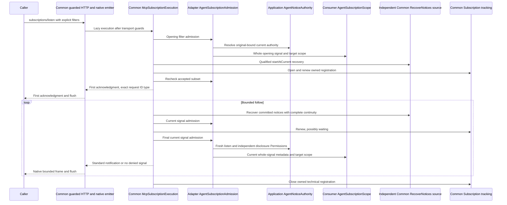

# Agent live Tool, Resource and whole-Skill disclosure

Unreleased [TASK-00093](../planning/tasks/00093-TASK.md) composes Common's actual Subscription admission,
retained source Queries, tracking and native HTTP delivery. The sufficient minimum is **Common v1.5.0**, source
`06fb5cd3720af9cf8295198f74040d95b64c5155`; the existing `^1.5.0` requirement suffices. Supplier acceptance and
publication are recorded in the [contract inventory](common-contracts.md). Independent Review ACCEPT and nonvisual
QA PASS cover candidate `55b9ccb0b6ad6ef3533d99e99cae63ab98cb7657`; the owning TASK and canonical Land handoff
retain integration/delivery provenance. This is library composition, not consumer adoption or production qualification.

## Runtime ownership



Existing implementation view at `59f4b90961d1f180eba869c16856c262054b4b68`; later handoff-prose changes retain
these source/test bytes. Common arrows describe released source `06fb5cd3720af9cf8295198f74040d95b64c5155`.
Solid arrows are calls, dashed arrows returned frames/data. Family metadata checks inside Agent admission are
abbreviated; the emitter drives execution, so frame-return arrows do not imply a background worker or durable queue.
Source: `src/Adapter/Mcp/Subscription/Agent/{AgentSubscriptionAdmission,AgentSubscriptionFamilies}.php`,
`src/Application/AccessControl/Agent/Notice/{AgentNoticeAuthority,AgentSubscriptionScope}.php`, and Common's
`Application/Mcp/Subscription/McpSubscriptionExecution::{run,notification,batch}`. The diagram omits bootstrap,
individual denials and failure closure; it proves neither receipt nor permission stability during transmission.

## Explicit trusted composition

Create an `AgentContinuationBinding::fromRequest()` from the same trusted request provider and signed request used
for opening. The binding retains original Agent/credential/revision/authentication time, not the signature or a
reusable nonce. It cannot be serialized. Reconnect authenticates a **new request** and creates a new binding; a
JSON-RPC ID, subscriber reference, `_meta`, recipient, role label or heartbeat is never authentication.

```php
use Fight\AccessControl\Adapter\Mcp\Subscription\Agent\AgentSubscriptionAdmission;
use Fight\AccessControl\Adapter\Mcp\Subscription\Agent\AgentSubscriptionFamilies;
use Fight\AccessControl\Application\AccessControl\Agent\Continuation\AgentContinuationBinding;
use Fight\AccessControl\Application\AccessControl\Agent\Notice\AgentNoticeAuthority;
use Fight\AccessControl\Domain\AccessControl\Permission\PermissionName;
use Fight\Common\Application\Mcp\Subscription\McpSubscriptions;

$binding = AgentContinuationBinding::fromRequest($requestProvider, $signedRequest, $correlationId);
$openingAuthority = new AgentNoticeAuthority(
    $binding, $agentRepository, $permissionRepository, $clock,
    [PermissionName::fromString('LISTEN_CHANGES')]
);
$disclosureAuthority = new AgentNoticeAuthority(
    $binding, $agentRepository, $permissionRepository, $clock,
    [PermissionName::fromString('DISCLOSE_CHANGES')]
);
$families = new AgentSubscriptionFamilies($toolRegistry, $toolCatalog, $resourceCatalog, $skillCatalog);
$admission = new AgentSubscriptionAdmission(
    $trustedSubscriberReference, $openingAuthority, $disclosureAuthority, $consumerSignalScope, $families
);
$subscriptions = new McpSubscriptions(
    $independentSourceQueryBus, $commonSubscriptionStore, $admission, $trustedSourceSelection,
    tools: $toolRegistry !== null, resources: $resourceCatalog !== null,
    maxFrameBytes: 8192
);
```

Names are illustrative consumer configuration, not package-defined grants. Requirements are nonempty conjunctive
`PermissionName` lists. Both authorities must use the **same original binding and repositories**. Each notification
requires listening **and** separate disclosure authority. Observed assignment-revision changes between those reads
refuse disclosure; a mismatched Agent/credential composition faults. No second authentication or nonce replay occurs.
Expired provenance, missing Agent, revocation or rotation deny; malformed authority/resolver/storage faults propagate
to Common's safe diagnostic/closure owner. Ordinary request-snapshot contracts and the existing synchronized
continuation guard are unchanged.

`AgentSubscriptionScope::allows(principal, filter, uri, notice)` is a consumer-owned current policy port. A null notice
is opening only. For each nonnull notice, independently admit the **entire** signal, its complete source metadata
and relationships, concealed catalog activity and any selected exact target. Explicit catalog-activity authority is
required: one visible Tool/Resource or a read grant is insufficient. Never infer scope from supplied filters,
recipients, IDs, topic names or an earlier allow. Faults throw; a deliberate false decision skips that signal.
Consumer per-family Permission requirements can be evaluated here against the fresh principal as well as scope.

## Family boundaries without protected content

Use the **same** Tool registry/catalog and Resource/Skill catalogs served by ordinary Common dispatch, not a copied
filtered registry. `AgentSubscriptionFamilies` is only metadata eligibility, not whole-signal scope:

- Tool signals need an enabled registry and at least one currently available exact Tool definition. Catalog
  requirement identity remains TASK-00084's exact immutable definition association. No Tool is executed.
- Resource catalog signals need currently available metadata; enumeration is limited to 10,000 descriptors and
  errors are not empty-success. Ordinary providers must honor their metadata-only enumeration/find contracts.
- Selected Resource updates need the exact saved URI's current owner/descriptor and general requirements, even
  if absent from listing. Unknown/unmapped targets deny. No automatic read, fetch, hashing or `open()` occurs.
- `McpSkillResources` additionally needs its exact complete immutable entry in the configured Skill catalog and
  **all** member Resource requirements, never a filtered partial manifest. Neither its old request-scoped
  availability object nor its content stream factory is invoked. Unknown protected-provider implementations deny:
  this composition cannot reinterpret their request-only policy as live authority. Consumers must explicitly
  qualify another provider's current-authority integration rather than bypass its independent protection.

Skills use `resourcesListChanged` / `resourceSubscriptions` and standard Resource notifications. No Skill method or
flag is invented. Prompt signals, subscriber inspection, publication/Mercure and full Task state are excluded and
remain separately owned. Their absence does not block enabled Tool/Resource listening.

## Shared source, independent recovery and truthful failure

Configure actual `RecoverNoticesHandler` / `NoticeRecovery` on a **separate trusted source QueryBus**, with the
consumer's independent producer context, authoritative source scope and `NoticeReadAdmission`. Never reuse a
listener's public browse admission as the source grant, or treat source access as recipient disclosure permission.
No duplicate SQL/filter/recovery engine is introduced. Common starts at current retained position, then follows its
shared coherent recovery Queries. Live requires truthful `complete`, including an access-history revision and
explicit permission for namespace-wide continuity evidence. Controlled policy fixtures provide those inputs.
Absent/changed historical evidence, incomplete scans or loss fail live continuity; retain independently authorized
polling/current-data reload instead of broadening grants or fabricating complete-empty catch-up.

Public reads/recovery still use [TASK-00092 admission](agent-notice-recovery.md) and a fresh ordinary request.
Interrupted/failed streams do not delete committed notices or grant recovery. Recording/publication are separate
operations. Generic notices must contain only safe metadata, never protected message/Tool bodies or full Task state.

Common recognizes `mcp.tools.list_changed`, `mcp.resources.list_changed`, and selected `mcp.resources.updated` with
exact `mcp/uri`. Output is respectively `notifications/tools/list_changed`, `notifications/resources/list_changed`
and `notifications/resources/updated`. Source metadata is not copied into these standard frames. Correlation is
`params._meta['io.modelcontextprotocol/subscriptionId']` with the **original integer or string** request ID; tracking
uses separate random registration and owner IDs, so simultaneous callers reusing JSON-RPC IDs are isolated.

Opening acknowledges only supported, requested, currently permitted filters, possibly an empty object. Common
rechecks the accepted subset after source/tracking callbacks and before acknowledgment. Notification admission
runs again **after** tracking renewal and immediately before framing/emission. A permission change **after that final
check** can precede sending: no send-spanning lock, all-writer fence, atomic check-and-send or retraction is promised.
For native delivery use Common's guarded endpoint, response factory and `McpResponseEmitter` with buffering and
compression disabled. The 8,192-byte frame ceiling above fits the native emitter's ordinary frame read. Arbitrary
small PSR fragments or whole-response buffering may retain already checked bytes and are **not** evidence of a fresh
check per later fragment, live delivery, client processing or receipt. Proxies/SAPI/client buffering need consumer
qualification. No transaction is held across network wait.

Common's finite bounds include 16 selected URIs (each at most 2,048 bytes), explicit Boolean filters, 30-second
default lifetime (1–120), 200,000-microsecond default wait (10,000–1,000,000), 16,384-byte default frames
(256–65,536), 12,000 cooperative checks, one pending transport frame and bounded shared recovery batches (32 notices,
100 examined rows by default). Tracking has a five-second freshness lease, at most 256 active and 4,096 retained
registrations with separately bounded cleanup. Use one request/execution-local tracking store and its dedicated
idle connection, separate from notice storage/transactions. Do not share a failed store instance between streams:
Common intentionally invalidates it after a storage fault. Native failure/disconnect closes owned tracking without claiming
receipt; slow reads can lose freshness. Heartbeat comments disclose no business state and authorize nothing.
Source/tracking/operational/framing failures never emit successful completion or private diagnostic text. Diagnostics
use Common's single supplied redaction-aware sink, not a second logger or exception-to-denial fallback.

## Evidence and limits

`tests/Adapter/Mcp/Subscription/Agent/` exercises real AccessControl authority, Common routed recovery, DBAL SQLite
notice/tracking, Sodium continuation, exact Resource/whole-Skill bindings and native HTTP endpoint/emitter. The
native SAPI fixture proves acknowledgment and signal bytes arrive before finite closure, checks correlation type
and preserves HTTP Accept safeguards. Controlled scheduling covers queued denial and tracking callbacks; actual
storage/transport faults, slow-reader freshness, idle closure, separate-principal same-ID streams and independently
admitted retained recovery remain distinct scenarios. The native fixture uses an explicitly trusted handoff; owning
request tests separately prove authentication and one nonce without replay.

Minimum/ordinary dependency identities, exact coverage, complete gate logs, warnings and runtime locators belong to
the canonical Work handoff. Minimum compatibility resolution reports 40 advisories in 12 packages; ordinary
resolution reports none. These fixtures qualify package composition, **not** production consumer DB/crypto/policy,
all authority writers, access-history restoration, concurrency schedules, proxies, buffering or client receipt.
Nonvisual actual wire/admission/Query/state evidence is useful here; UI screenshots would prove none of these rules.
Independent Review and behavioral QA accept the named candidate above. No release, deployment or exactly-once
delivery is claimed.
