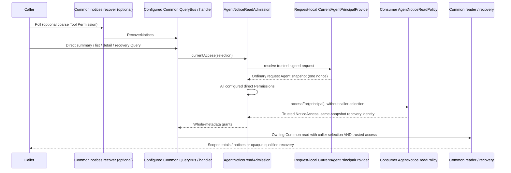

# Agent retained inspection and polling recovery

Unreleased [TASK-00092](../planning/tasks/00092-TASK.md) adds inward `AgentNoticeReadAdmission` and consumer
`AgentNoticeReadPolicy`. Common **v1.5.0**, published source `06fb5cd3720af9cf8295198f74040d95b64c5155`, is the
first sufficient supported minimum for these read/recovery/polling contracts. The existing `^1.5.0` requirement
already suffices. See the [supplier inventory](common-contracts.md). Independent Review ACCEPT and nonvisual
QA PASS cover candidate `d989bdb25b897bd43c7ae87cd76e63498d18f561`; this is not production consumer qualification.

## Ownership and request flow



The source owners are `src/Application/AccessControl/Agent/Notice/{AgentNoticeReadAdmission,AgentNoticeReadPolicy}`.
They add no Query, SQL, repository, cursor codec, completeness engine, schema or Tool. The diagram describes their
existing implementation at `d989bdb25b897bd43c7ae87cd76e63498d18f561` against base
`97e75f18d52bfc078dcd6cf8d25618c27edf1018`. Solid arrows denote calls, dashed arrows returned data; the final
reader-to-caller arrow abbreviates the return through the handler/bus. Source and executable traces are in
canonical `.runs/handoffs/TASK-00092/work.md`. The view omits bootstrap, storage internals and failure branches;
it is not proof of consumer policy or production concurrency. Screenshots cannot prove library admission,
concealment, effects or continuation semantics; routed response/state tests provide Before/After evidence instead.

## Explicit composition

Construct one fresh `CurrentAgentPrincipalProvider` and signed request per ordinary request, sharing it with any
coarse Tool availability. Do not reuse the provider across later calls/pages/polls. Configure **nonempty conjunctive
PermissionName objects**, not request strings; malformed/empty configuration fails immediately. Illustrative names
below are consumer configuration, not package-defined Permissions or automatic grants.

```php
use Fight\AccessControl\Application\AccessControl\Agent\Notice\AgentNoticeReadAdmission;
use Fight\AccessControl\Domain\AccessControl\Permission\PermissionName;
use Fight\Common\Adapter\Mcp\Notice\SodiumNoticeContinuationProtector;
use Fight\Common\Adapter\Mcp\Persistence\Notice\Dbal\DbalNoticeReader;
use Fight\Common\Adapter\Mcp\Persistence\Notice\Dbal\DbalNoticeRecoveryReader;
use Fight\Common\Adapter\Mcp\Tool\Notice\RecoverNoticesTool;
use Fight\Common\Adapter\Messaging\Query\Routing\InMemoryQueryRouter;
use Fight\Common\Adapter\Messaging\Query\RoutingQueryBus;
use Fight\Common\Application\Mcp\Notice\QueryHandler\GetNoticeHandler;
use Fight\Common\Application\Mcp\Notice\QueryHandler\ListNoticesHandler;
use Fight\Common\Application\Mcp\Notice\QueryHandler\RecoverNoticesHandler;
use Fight\Common\Application\Mcp\Notice\QueryHandler\SummarizeNoticesHandler;
use Fight\Common\Application\Mcp\Notice\Service\NoticeRecovery;

$admission = new AgentNoticeReadAdmission(
    $requestProvider, $signedRequest, $correlationId,
    [PermissionName::fromString('READ_NOTICES')], $consumerReadPolicy
);
$reader = new DbalNoticeReader($idleNoticeConnection);
$recovery = new NoticeRecovery(
    new DbalNoticeRecoveryReader($idleNoticeConnection),
    new SodiumNoticeContinuationProtector($dedicatedKeyRing, $activeKeyId)
);
$handlers = [
    new SummarizeNoticesHandler($admission, $reader),
    new ListNoticesHandler($admission, $reader),
    new GetNoticeHandler($admission, $reader),
    new RecoverNoticesHandler($admission, $recovery)
];
$map = [];
foreach ($handlers as $handler) {
    $map[$handler::queryRegistration()] = $handler;
}
$router = new InMemoryQueryRouter();
$router->registerHandlers($map);
$queryBus = new RoutingQueryBus($router);
$pollingTool = new RecoverNoticesTool($queryBus);
```

This concrete DBAL wiring belongs to consumer bootstrap/Adapter, never inward in Application. DBAL `^4.4` remains
only a development dependency here. Consumers own actual storage and schema installation. All direct/alternate
Query paths must use these admissions; adding only Tool availability is insufficient. Expose the unchanged Common
Tool with an explicit `AgentToolPermissionCatalog` mapping for `notices.recover` and `AgentToolAvailability`, as in
[Tool composition](agent-mcp-authorization.md). Tool availability grants no scope. Polling requires no Subscription,
Mercure, TASK-00088 continuation binding, Agent mutation wrapper or live runtime.

## Trusted scope and historical evidence

`AgentNoticeReadPolicy::accessFor(AuthenticatedAgentPrincipal): NoticeAccess` receives no caller selection. Resolve
trusted scope independently of topic/recipient/subject/role labels, IDs, previous pages or continuation possession.
Use `NoticeAccess::create($trustedScopes, $trustedFilters, $recoveryIdentity)`. Empty scopes deliberately exclude all
notices; faults must throw. Grant a notice only if its **entire** safe metadata and every subject, recipient, author,
command, event and action relationship are disclosable. Exclude/deny rather than create a field-redacted success.
Recording/removal/listen/publication or human rights confer no Agent read authority.

Common intersects caller and trusted predicates **before** rows, full-selection page totals, summary dimensions,
timestamps and relationship-derived statistics. Direct detail needs no prior listing; excluded, unknown and removed
notices return the same null. These are live scans with committed-isolation/idle-connection requirements, not a
frozen snapshot or retention lease. Operational/policy/hydration faults are never manufactured empty success.

For recovery, the policy must supply `NoticeRecoveryIdentity($caller, $revision, $namespaceEvidence)` from the **same
trusted grant snapshot**. Bind caller to the authenticated Agent (and any consumer identity boundary); never take it
from MCP input. The access revision is trusted historical evidence: change it for **every intervening eligibility
change**, including Agent/credential/Permission changes, revoke-restore, consumer sharing/filter changes and newly
eligible older notices. Current permission equality or the Agent assignment revision alone cannot prove that whole
history. Restored or unavailable evidence must not reuse an old epoch. `namespaceEvidence: true` additionally
requires permission to reveal namespace-wide history-loss facts. It is not implied by a scoped read grant.

Without trustworthy revision or namespace-evidence permission, supply a null revision / false evidence: authorized
polling remains **uncertain**, even when empty. Without trusted caller identity recovery fails. Genuine `complete`
requires truthful continuity, an exhausted coherent scan and unbroken retained history. `incomplete` means the
qualified scan is bounded or history was lost; it is not acknowledgment of processing. Controlled fixtures establish
complete and incomplete honestly; absent evidence is not an operator-input hold or permission to broaden grants.

## Continuation, bounds and failures

Common owns caller/selection/grant/serving-bound opaque continuation. Use its Sodium XChaCha20-Poly1305 protector
with dedicated 32-byte keys, valid eight-character key IDs and retained rotation keys as appropriate. It encrypts,
authenticates and pads private namespace/position/loss/binding/expiry state. Base64 or MAC-only encoding is **not**
secrecy. Tokens expire (default 300 seconds; allowed 1–900), and tampering, changed caller/access/selection/config,
namespace replacement, retired keys or incompatible boundaries require a fresh admitted restart. Never decode or
expose storage watermarks as public recovery evidence.

Common defaults to 32 returned notices, at most 100 scanned records, 65,536 encoded recovery-result bytes and a
1,048,576-byte final Tool response. Query batch sizes are 1–32, scan limits 1–100; selection has at most 16 scopes,
continuations at most 2,048 bytes. Recovery-result configuration permits 2,048–262,144 bytes. Common owns finite
notice metadata/relationship limits and page bounds (maximum 32 rows). Scan budgets count examined filtered rows;
continuation does not advance past an eligible notice omitted for the return-count limit. Removal between batches,
including deletion of the last notice, retains loss evidence and cannot become healthy complete-empty catch-up.
Concurrent appends can be seen on subsequent calls; returned bytes cannot be retracted after later access changes.

The Tool retains its final response budget through `McpResult` to Common's `McpJsonResponse`/responder. Consumers
must use that final boundary: it counts text duplication, escaping, central metadata, request ID and JSON-RPC
envelope, not only structuredContent. Overflow fails rather than truncates; preserve the old token and restart or
retry with an appropriate bounded batch/configuration. Summary dimension/scan/hydration/output faults fail the
whole invocation, never partial totals or healthy empty success. Common handlers wrap read faults in
`NoticeReadFailed`; configure one safe reporting/presentation boundary, not raw causes/diagnostics or an assumed
HTTP-to-MCP mapping. No protected body or full Task state belongs in generic notices or error output.

Reads add no business Command, mutation, domain event, processing receipt or cleanup. Initial authentication still
consumes one nonce, ordinary same-request Agent snapshots remain stable, and Common recovery still performs its
technical coherent storage transaction. Later requests authenticate/authorize again. Recording committed before
controlled publication failure remains independently recoverable; this proves no live delivery or receipt guarantee.

## Evidence and consumer limits

`tests/Application/AccessControl/Agent/Notice/AgentNoticeReadAdmissionTest.php` composes real request authentication,
Agent/Permission repositories, Common routed Commands/Queries, DBAL/SQLite readers/recovery, Sodium protection and
actual polling Tool/JSON-RPC encoding. It covers full-selection concealment, direct detail, conjunctive admission,
empty grants versus faults, request snapshot/later denial, controlled postcommit failure, bounded scans, appends,
removal/loss, changed access/caller/namespace, opaque tampering, uncertainty and encoded recovery/Tool bounds.
Minimum and ordinary locks, runtime/source identity, focused/exact coverage and final gate are retained in the
canonical Work handoff. Independent Review and nonvisual behavioral QA remain separate obligations.

These fixtures do **not** qualify real consumer policy/storage/cryptography/bootstrap, request lifetimes, historical
access evidence, retention/authority-writer races, deployed clients/hubs or production disclosure. Consumers must
qualify those implementations, including truthful revision transitions and whole-metadata grants. No all-writer
fence, atomic permission-through-send guarantee, production policy engine or sibling live feature is introduced.
