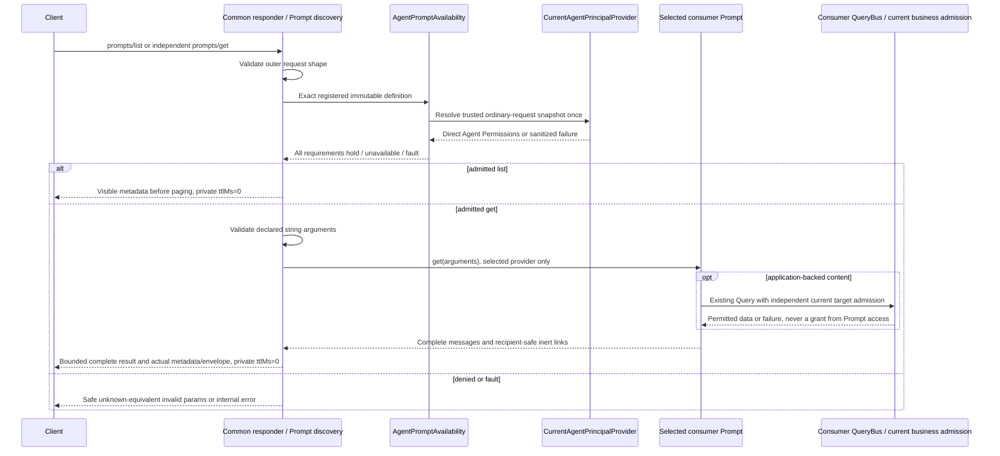

# Agent-protected MCP Prompts

[TASK-00087](../planning/tasks/00087-TASK.md) adds opt-in Prompt Permission composition in
`Fight\AccessControl\Adapter\Mcp\Prompt\Agent`. Common **v1.5.0** is the first sufficient supported stable
Prompt minimum, source `06fb5cd3720af9cf8295198f74040d95b64c5155`; the existing manifest `^1.5.0` already supplies it.
[Supplier qualification](common-contracts.md) records independent acceptance and the published-tag bridge.
This unreleased feature does not complete or select a version for the combined [EPIC-00014](../planning/epics/00014-EPIC.md).

## Explicit definition associations

| Type | Contract |
| --- | --- |
| `AgentPromptPermissionBinding` | Implements Common `McpPrompt`. Takes the consumer's actual `McpPrompt` provider and a nonempty list of canonical Permission-name strings. Validates every requirement, snapshots `info()` once and delegates `get()` without modifying arguments or complete output. |
| `AgentPromptPermissionCatalog` | Takes a list of bindings; rejects malformed entries and repeated/conflicting associations to the same definition object. `prompts()` exports the bound providers; `requirementsFor(McpPromptInfo)` returns conjunctive requirements only for that exact immutable object, otherwise null. It is an association table, not another name registry. |
| `AgentPromptAvailability` | Implements Common `McpPromptAvailability`. Takes the catalog, the ordinary request's trusted `CurrentAgentPrincipalProvider`, `SignedAgentRequest` and safe nonempty correlation ID. Retains one success or failure for that request, never authenticating per definition. |

```php
use Fight\AccessControl\Adapter\Mcp\Prompt\Agent\AgentPromptAvailability;
use Fight\AccessControl\Adapter\Mcp\Prompt\Agent\AgentPromptPermissionBinding;
use Fight\AccessControl\Adapter\Mcp\Prompt\Agent\AgentPromptPermissionCatalog;
use Fight\Common\Application\Mcp\Prompt\McpPromptDiscovery;

// Consumer-owned providers implement Common's actual McpPrompt contract.
$catalog = new AgentPromptPermissionCatalog([
    new AgentPromptPermissionBinding($staticInstructions, ['VIEW_DOCUMENTS']),
    new AgentPromptPermissionBinding($queryBackedInstructions, ['VIEW_DOCUMENTS', 'READ_DOCUMENTS'])
]);
$availability = new AgentPromptAvailability($catalog, $principalProvider, $signedRequest, $correlationId);
$prompts = new McpPromptDiscovery($catalog->prompts(), $availability, $cursorKey, 'consumer-prompt-endpoint');
// Register $prompts in the consumer's Common McpCapabilityRegistry / McpResponder.
```

Consumers supply the named dependencies, actual grants and stable dedicated cursor secret (32–4096 bytes),
not an Agent credential. Register **exactly `prompts()`** with the matching availability. Do not independently
swap/wrap/add providers, share a definition object among distinct owners, or call the wrapped provider to bypass
admission. Rebuild bindings and Common composition together when changing registration. These are trusted
composition hooks, not authentication of hostile PHP objects; direct provider and alternate business entry points
retain their own protection. Consumer providers are trusted application code, not sandboxed templates.

Binding inputs deliberately accept dynamic arrays and validate list structure, string members and canonical
`PermissionName` values without trimming/normalization. Repeated Permission names remain conjunctive. Empty,
malformed and conflicting associations reject statically; empty catalogs serve nothing. Equivalent foreign metadata,
unknown definitions and unbound providers deny without resolving authority, never become public by default. Requirements
are direct Agent Permissions, not OAuth scopes, human Roles, caller-supplied arrays, names or Prompt arguments.

Binding snapshots the actual upstream `McpPromptInfo` object without cloning or implementing its grammar. Common
registers that object, owns naming/duplicate-name rejection and all definition/catalog budgets, **including concealed
entries**. A provider later returning different metadata cannot reassign an existing binding. Metadata and listing
must never construct content, dispatch a business Query or open linked bytes. No production Prompt provider is shipped.

## Runtime flow and request lifetime

The maintained diagram corresponds to
[`AgentPromptPermissionBinding`](../src/Adapter/Mcp/Prompt/Agent/AgentPromptPermissionBinding.php),
[`AgentPromptPermissionCatalog`](../src/Adapter/Mcp/Prompt/Agent/AgentPromptPermissionCatalog.php),
[`AgentPromptAvailability`](../src/Adapter/Mcp/Prompt/Agent/AgentPromptAvailability.php) and Common's released
[`McpPromptDiscovery`](https://github.com/johnnickell/fight-common/blob/06fb5cd3720af9cf8295198f74040d95b64c5155/src/Application/Mcp/Prompt/McpPromptDiscovery.php).



Create fresh availability **and principal-provider instances for every ordinary request**, including later pages,
saved names and direct gets. Share the same trusted provider/signed request with earlier authentication and other
cooperating gates **within** that request. A resolved short request retains its immutable snapshot; later requests
observe revocation, credential replacement and Permission removal/regrant. Rejected resolution is not retried per
Prompt. No singleton/job/stream reuse or shared cached allow is supported. Existing nonce consumption/fences stay
inward; this adapter adds no business Command, event, grant, mutation or commit.

Listing filters all permitted metadata before Common's ordering/pagination and never invokes `get()`. Direct get
needs no listing. Common's cursor authenticates the visible catalog and endpoint/serving parameters, not authority;
changed visible metadata/eligibility invalidates a saved continuation, while concealed changes do not reveal themselves
through it. Every response remains private with zero TTL. Static bodies, immutable definitions, saved cursors and
previous successful responses confer no cross-request access and justify no shared response/principal cache.

## Safe failures, completeness and independent targets

- Unknown/unmapped definitions, missing any direct requirement, deliberate authentication refusal and request-fence
  authority changes are unavailable. Common conceals denied get exactly like an unknown name (`-32602`), **before
  declared-argument validation or provider/Query work**. Outer request shape is still validated earlier by Common.
- Invalid declared arguments remain Common's safe invalid-params result. Policy/provider/storage failures and invalid
  authoritative Permission snapshots are **internal failures**, not an empty catalog or partial success. Availability
  retains and rethrows sanitized resolution faults. `McpResponder::respond()` reports once through its configured
  diagnostics owner and emits constant `-32603 / Internal error.` without a result. Direct `dispatch()`/capability/
  provider calls need their own appropriate safe boundary. Provider-injected protocol errors cannot expose private
  diagnostics. This package installs no second logger or renderer; qualify actual diagnostic-sink redaction separately.
- Common alone validates bounded declarations, declared string arguments, complete message/link representation and
  finite encoded catalog/input/output/result/central-metadata/actual-envelope limits. Oversized or malformed content
  fails atomically, never truncates into fabricated empty/partial success. Preserve these bounds when configuring
  Common limits. Static instructions require no invented Query or template engine.
- Application-backed providers use the configured Common QueryBus and the existing consumer/shared Query. The handler
  independently checks current business/target access **before** protected data reads; capability-allowed/data-denied
  must fail without embedding that data. Prompt permission never grants project/document/session scope. Protect
  alternate/direct Query/provider paths independently.
- Resource and Skill links are inert recipient-safe metadata. Retrieval never fetches linked content, grants later
  reads, activates a Skill, executes a Tool/model, confers Workflow/human authority or changes application records.
  Each later Resource operation needs independent target admission. See [Resource](agent-resource-authorization.md)
  and [whole-Skill](agent-skill-authorization.md) composition; static Prompt serving has no dependency on enabling them.

## Package evidence and consumer limits

`tests/Adapter/Mcp/Prompt/Agent/AgentPromptAvailabilityTest.php` exercises the actual Common responder/list/get with
real AccessControl authority/Permission resolution over controlled repositories and crypto ports: malformed/conflicting/
foreign mappings, every missing requirement, lazy selected providers, immutable metadata, direct get, one nonce,
request snapshots/fresh pages/revocation/rotation/removal/regrant, safe faults, arguments and atomic finite budgets.
Controlled QueryBus/handler and Common Resource fixtures prove independent current data admission and later denial
of both Resource/Skill links without automatic content reads. These are package composition assertions, not actual
consumer databases, cryptography, transport, bootstrap/container lifetimes, storage/parser containment, sink redaction,
client caching or deployed provider qualification. Screenshots add no useful evidence for these nonvisual MCP effects.

The canonical Work handoff records exact minimum and ordinary Composer lanes, installed tagged-source/lock evidence,
focused counts, exact owned statements, complete gate log/actual exit/receipt, warnings and retained runtime. Independent
technical Review and behavioral QA remain separately required. No consumer change, publication, merge, release,
deployment or completion of the combined future release is claimed by this guide.
