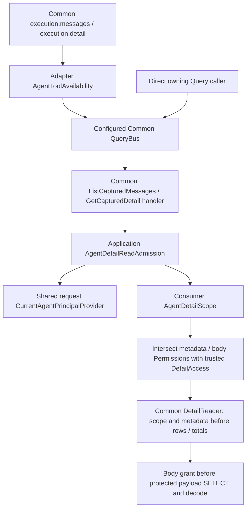

# Agent-protected captured detail

TASK-00090 adds `Application\AccessControl\Agent\Detail\AgentDetailReadAdmission`, implementing Common's
`DetailReadAdmission`. It uses actual ordinary-request Agent authentication and exact direct Permissions, not a
Tool allow, Role label, selector, supplied Permission array or timeline reference. Consumers implement
`AgentDetailScope::currentAccess(AuthenticatedAgentPrincipal, DetailSelection): DetailAccess` with authoritative
current relationships/sharing and separately configured metadata/body grants. No relationship store, reader,
Permission vocabulary, grant provisioning or content implementation is supplied here.

## Compose the owning Queries

Construct one fresh `CurrentAgentPrincipalProvider` and signed request per ordinary request. Share them between
Tool availability and this admission; multiple admission decisions do not consume the authenticated nonce again.
Supply two nonempty **conjunctive** lists of unique `PermissionName` values. Empty, non-list, duplicate and untyped
requirements reject construction through the existing `PermissionDeclaration`. The names below are examples
chosen/provisioned by a consumer, not managed package definitions.

```php
use Fight\AccessControl\Application\AccessControl\Agent\Detail\AgentDetailReadAdmission;
use Fight\AccessControl\Domain\AccessControl\Permission\PermissionName;
use Fight\Common\Adapter\Mcp\Tool\Detail\GetCapturedDetailTool;
use Fight\Common\Adapter\Mcp\Tool\Detail\ListCapturedMessagesTool;
use Fight\Common\Adapter\Messaging\Query\Routing\InMemoryQueryRouter;
use Fight\Common\Adapter\Messaging\Query\RoutingQueryBus;
use Fight\Common\Application\Mcp\Detail\QueryHandler\GetCapturedDetailHandler;
use Fight\Common\Application\Mcp\Detail\QueryHandler\ListCapturedMessagesHandler;

$admission = new AgentDetailReadAdmission(
    $provider,
    $signedRequest,
    $correlationId,
    $trustedConsumerScope,
    [PermissionName::fromString('VIEW_EXECUTION_METADATA')],
    [PermissionName::fromString('VIEW_EXECUTION_BODY')]
);
$router = new InMemoryQueryRouter();
$router->registerHandler(
    GetCapturedDetailHandler::queryRegistration(),
    new GetCapturedDetailHandler($admission, $commonDetailReader)
);
$router->registerHandler(
    ListCapturedMessagesHandler::queryRegistration(),
    new ListCapturedMessagesHandler($admission, $commonDetailReader)
);
$queryBus = new RoutingQueryBus($router);
$tools = [new ListCapturedMessagesTool($queryBus), new GetCapturedDetailTool($queryBus)];
```

`$trustedConsumerScope` and `$commonDetailReader` are required trusted composition inputs. The reader above is
Common's supported `DetailReader`; the package fixture uses its real `DbalDetailReader` with Common-owned SQLite
schema/repositories. Consumers select and qualify their own supported persistence. No Common Adapter type enters
AccessControl production Application code. Bind the exact Tool definitions through the existing
[Tool catalog/availability](agent-mcp-authorization.md), with metadata/coarse requirements only, **not** mandatory
body Permission merely to make `execution.messages` or `execution.detail` available. Do not register an alternate
unprotected handler for the same owning Queries. Direct Query/console callers use this same admission; direct
`handle()` on a Tool still reaches the configured Query admission, although it does not add coarse availability.
Workers doing repeated continuation need the separate [continuation contract](agent-continuation-authorization.md),
not a long-lived ordinary-request provider.

### Source-linked runtime flow



Authoring sources: `src/Application/AccessControl/Agent/Detail/{AgentDetailReadAdmission,AgentDetailScope}.php`,
Common v1.5.0's `Application/Mcp/Detail/QueryHandler` and `Adapter/Mcp/Persistence/Detail/Dbal/DbalDetailReader.php`.
The TASK Work handoff maps the authored diagram and tested source to the committed candidate.

## Independent admission matrix

| Direct metadata Permission | Direct body Permission | Trusted structural/metadata scope | Result |
| --- | --- | --- | --- |
| Missing | Either | Either | Empty `DetailAccess`; Common returns concealed nullable data, with no body retrieval |
| Present | Either | Denied | Common concealment, not presentation-only row filtering |
| Present | Missing | Admitted | Actual metadata projection with `body_permitted: false`, `chunk: null` |
| Present | Present | Admitted, body scope denied | Metadata-only projection; direct Permission cannot expand consumer scope |
| Present | Present | Admitted, body scope admitted | Actual bounded Common content projection, subject to current storage availability |

Metadata admission never requires timeline Permission. Independently admitted detail works without timeline
access. Timeline grants, safe optional target/timing/result facts and disclosed references grant neither metadata
nor bytes. Body-only authority cannot bypass metadata or structural admission. When body Permission is missing,
the helper preserves the consumer's project/session/phase and metadata restrictions but removes **all** body grants.
When both Permissions hold, it returns only the consumer's existing access; it never reconstructs grants from selectors.

Common's SQL intersects project/session/phase and exact producer/detail metadata grants before returning selected
rows and full-selection totals. Its relationship checks protect activity/detail/kind and producer/parent identities.
Missing/concealed activity/detail returns null; an admitted empty activity returns an actual zero-total page.
A page outside the permitted selection retains its permitted total and empty rows, not a global hidden count.

## Freshness, content and errors

- Every owning Query invokes consumer scope again. Later pages/chunks require a new ordinary request/provider;
  revocation, credential rotation and Permission/relationship changes then affect admission. An already resolved
  request keeps its immutable principal snapshot. Prior pages, references, cached bytes and end-of-bytes confer no
  lease. Checks do not promise access stability after their final check or atomic check-and-disclosure.
- Tagged Common accepts UTF-8 captured strings, **not arbitrary non-UTF-8 binary capture**. Byte chunks are Base64,
  can split UTF-8 code points and must be reconstructed byte-exactly; never decode each chunk as independent text.
  `GetCapturedDetail` allows offset 0–65,536 and length 1–4,096. Message pages allow 1–32 entries (default 32) and
  include at most the initial 1,024 body bytes per selected message; full reads use detail chunks. Capture limits
  are 65,536 bytes, or 16,384 per process-output segment. Keep actual Common finite encoded-output validation;
  do not copy schemas/values or infer full capture from a final chunk.
- `complete`, `partial`, `unknown`, `unavailable` and `expired` capture facts remain distinct from retention.
  An admitted captured empty string has an empty chunk; unavailable bytes have null chunk. Retained bytes may
  disappear after a page/chunk or between metadata and retrieval. Missing records conceal; removed content can
  retain metadata with truthful `missing` availability. Never fabricate empty success or a new redacted schema.
- Metadata-only Common readers inspect safe content **presence**, not its payload. The package SQL trace measures
  actual `SELECT payload` boundaries: denied body paths perform zero retrievals/decodes; admitted paths retrieve
  only selected bodies. No cipher/opening adapter exists in this Common reader. This measures that actual opening
  boundary rather than asserting a fictitious decryptor count.
- Permission/scope faults propagate from this admission, not Boolean denial or empty successful pages. Common
  storage faults retain `ExecutionReadFailed`; the Tool invoker retains its safe failure and the single Common
  responder presents protocol-safe errors. Consumers must redact diagnostic causes at their diagnostic sink;
  wrapped throwables can retain private causes. Never log/serialize arbitrary exceptions or protected bytes.
  Invalid selection/ranges retain Common invalid-input outcomes. Reads dispatch no mutation Command or checking
  Event and change no business state; initial nonce consumption remains authentication's separate side effect.

## Qualified supplier and evidence limits

Common **v1.5.0**, source `06fb5cd3720af9cf8295198f74040d95b64c5155`, is the first sufficient supported minimum;
`^1.5.0` already exists in `composer.json`. [Canonical adoption](common-contracts.md) / TASK-00110 record supplier
independent acceptance/publication. TASK-00090 tests the exact minimum via `composer update --prefer-lowest
--prefer-stable` and restores ordinary `composer update` before its full gate. Both selected the same Common tag;
other dependency versions differ. Complete lock copies, SHA-256 identities, actual logs/exits and coverage are in
the canonical TASK Work handoff, not a tracked library lockfile. Minimum-lane development dependencies report
40 advisories across 12 packages; this is qualification evidence, not a deployment recommendation. Ordinary
resolution reports no advisories. Feature independent Review/behavioral QA remain separate from Work proof.

The controlled fixture authenticates through real AccessControl authority with modeled HMAC verification and
in-memory Agent/Permission persistence, then uses real Common buses, handlers, DBAL/SQLite schema/readers and
Tool/responder projections. It proves package composition, not deployed cryptography, production membership,
persistence/concurrency, transport lifetimes, diagnostic sinks or retention. Actual consumer sharing/relationship
policy and race/storage qualification stay with the consumer. TASK-00089's timeline integration is independent;
this feature does not implement it or qualify sibling live transport, release, deployment or consumer adoption.
