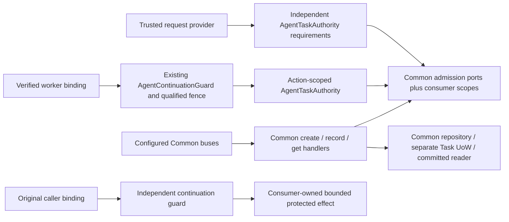

# Agent Task admission — slices A–E (unreleased)

TASK-00097 composes independent direct Agent Permissions and consumer-owned scope with Common's actual Task
creation, producer transition and complete current-state Query. It adds no Task lifecycle, persistence adapter,
executor, scheduler, grant, protocol endpoint or advertised partial MCP Tasks extension. TASK-00098 adds independent
bounded retained-data removal below. TASK-00099 adds durable input admission and protected continuation below.
TASK-00100 adds independent cancellation requests and protected intent observation below. TASK-00101 adds explicit
complete MCP serving and independent handle-response admission below. TASK-00102 adds
[optional complete Task notifications](agent-task-live.md), with current original-bound state admission and Common's
required disclosure guard. Ordinary polling/input/cancel retain no live dependency.

## Contracts and ownership

Policy lives in `Application/AccessControl/Agent/Task`. The admission implementations satisfy the actual
Common `Application/Mcp/Task/Service` ports. Configure them on Common handlers, including alternate bus entry points;
a Tool-only check is insufficient.

| AccessControl type | Purpose |
| --- | --- |
| `AgentTaskAuthority::fromRequest()` | One nonempty conjunctive list of canonical `PermissionName` values over the trusted request-owned `CurrentAgentPrincipalProvider`, signed request and safe correlation ID. No human principal or copied principal factory. |
| `AgentTaskCreationAdmission` / `AgentTaskCreationScope` | Independent creation Permission and authoritative original-operation/producer/scope decision before lookup, payload comparison or mutation, including retries. |
| `AgentTaskUpdateAdmission` / `AgentTaskUpdateScope` | Independent producer Permission and current trusted producer/Task/operation association, before concealed lookup on each attempt. The supplied producer string is not producer authentication. |
| `AgentTaskRemovalAdmission` / `AgentTaskRemovalScope` | Independent removal Permission and current consumer eligibility/holds/scope for every explicit identity, including missing targets and repeats, before any deletion. |
| `AgentTaskReadAdmission` / `AgentTaskReadScope` | Independent Permission and current sharing over **all** state, messages, input definitions, results, errors and metadata. Another independently authorized Agent may read; creator identity is not required or sufficient. |
| `AgentTaskAuthority::duringContinuation()` | Existing TASK-00088 guarded bounded action with an ephemeral authority usable only during that action. Supports trusted worker handoffs without signed-request replay or retaining a provider singleton. |
| `AgentTaskContinuationScope` | Delegates current scope and retains the fresh guard principal. A qualified fence must recognize this wrapper and fence the exact `getScope()` consumer policy and every participating writer. It is not an authority factory. |

Permission names are consumer configuration, not newly seeded names or implicit ADMIN grants. Examples below use
`TASK_CREATE`, `TASK_UPDATE`, `TASK_READ` and `TASK_CONTINUE` only as illustrative independent requirements. Multiple
requirements remain conjunctive; empty, associative or non-`PermissionName` configuration throws `LogicException`.
Consumers choose separate requirements/instances for each operation. Do not inject a creation authority as the
read authority just because it is already available.

Scope ports receive selectors and an actually authenticated Agent snapshot. They must consult authoritative
consumer relationships, trusted producer association and original-operation policy. They grant nothing from IDs,
metadata, capability declarations, Role labels, handle possession, prior success or current Tool availability.
Scope must not create business Commands/events, renew TTL or mutate a business aggregate while checking. Unavailable
policy throws, rather than returning permissive scope or a fabricated successful empty result.

## Runtime ownership



Source anchors: [authority](../src/Application/AccessControl/Agent/Task/AgentTaskAuthority.php),
[scope wrapper](../src/Application/AccessControl/Agent/Task/AgentTaskContinuationScope.php),
[original guard](../src/Application/AccessControl/Agent/Continuation/AgentContinuationGuard.php), and
[executable composition](../tests/Application/AccessControl/Agent/Task/AgentTaskAdmissionTest.php).
This maintained diagram's authoring source is the fenced Mermaid above; it describes slice A, not live MCP serving.

## Configure the real handlers and buses

These are composition excerpts, not a new service or complete bootstrap. The consumer supplies repositories,
separate Task UoW/committed reader, event dispatcher, server millisecond clock and actual scope implementations.

```php
use Fight\AccessControl\Application\AccessControl\Agent\Task\AgentTaskAuthority;
use Fight\AccessControl\Application\AccessControl\Agent\Task\AgentTaskCreationAdmission;
use Fight\AccessControl\Application\AccessControl\Agent\Task\AgentTaskReadAdmission;
use Fight\AccessControl\Application\AccessControl\Agent\Task\AgentTaskUpdateAdmission;
use Fight\AccessControl\Domain\AccessControl\Permission\PermissionName;
use Fight\Common\Application\Mcp\Task\CommandHandler\CreateTaskHandler;
use Fight\Common\Application\Mcp\Task\CommandHandler\RecordTaskStateHandler;
use Fight\Common\Application\Mcp\Task\QueryHandler\GetTaskHandler;

$createAuthority = AgentTaskAuthority::fromRequest(
    $provider, $signedRequest, $correlationId, [PermissionName::fromString('TASK_CREATE')]
);
$updateAuthority = AgentTaskAuthority::fromRequest(
    $producerProvider, $producerRequest, $correlationId, [PermissionName::fromString('TASK_UPDATE')]
);
$readAuthority = AgentTaskAuthority::fromRequest(
    $provider, $signedRequest, $correlationId, [PermissionName::fromString('TASK_READ')]
);
$create = new CreateTaskHandler(
    $taskRepository, $taskUnitOfWork, new AgentTaskCreationAdmission($createAuthority, $createScope),
    $payloadPolicy, $eventDispatcher, $millisecondClock
);
$update = new RecordTaskStateHandler(
    $taskRepository, $taskUnitOfWork, new AgentTaskUpdateAdmission($updateAuthority, $producerScope),
    $payloadPolicy, $eventDispatcher, $millisecondClock
);
$read = new GetTaskHandler(
    $committedTaskReader, new AgentTaskReadAdmission($readAuthority, $readScope), $payloadPolicy, $millisecondClock
);
$commandRouter->registerHandler($create::commandRegistration(), $create);
$commandRouter->registerHandler($update::commandRegistration(), $update);
$queryRouter->registerHandler($read::queryRegistration(), $read);
```

Use actual `CreateTask`, `RecordTaskState` and `GetTask` payloads through Common's configured buses. Common owns its
transaction; do **not** wrap it in an enclosing application DB transaction. The independent read repository need
not expose writes. Common's `ToolTaskPayloadPolicy` validates against the **retained original** Tool contract,
not an unrelated currently registered Tool. Supply its independent all-field safe-disclosure callback and constant
safe execution-error mappings. Admission is not payload sanitization.

Common checks creation/update admission within its serialized mutation boundary, including repeats, terminal,
expired and absent paths. It validates payloads and owns atomic state/version/retry/terminal winner behavior.
Queries use a committed coherent snapshot, then comparison and final independent whole-state disclosure checks.
They neither execute work nor commit, publish checking events, clean expired rows or renew retention.

### Comparison continuity and complete states

`AgentTaskReadScope::comparisonScope()` supplies Common's bounded case-sensitive reference (1–96 characters under
`TaskDefinition::reference`). Bind the admitted reader and **durable visibility epoch** across processes/reconnects.
Rotate after sharing/authority discontinuity, restoration or revoke/regrant. A handle, permission list or constant
shared by all readers is not such evidence. Without continuity, return a fresh valid opaque reference so Common's
safe restart semantics remain intact. The adapter checks read authority/scope before requesting this context;
Common performs its final scope/disclosure checks after callbacks and projection.

Allowed reads return Common's complete actual state, never a redacted/empty successful substitute. `working`,
`input_required`, `completed`, `failed` and `cancelled` remain coherent. Completed Tool `isError: true` is not a failed
Task with a safe JSON-RPC execution error. Original context remains retained, not publicly added to a safe event.
Common preserves actual TTL/absence/polling/revision metadata and finite encoded bounds: original operation context
8192 bytes, Task state 32768 bytes, stored aggregate 40960 bytes, plus its other input/projection limits. Limits
compose; individually valid components do not promise a valid aggregate at their combined maxima. Nothing truncates
protected content or fabricates partial success.

## Background producers and original caller continuation

Ordinary request authorities intentionally share the provider's one authenticated snapshot and nonce result.
They must not survive that request or be held as a worker singleton. For a bounded background report, reconstruct
a **producer** binding only through `AgentContinuationBinding::fromHandoff($trustedProducerVerifier)`, then:

```php
AgentTaskAuthority::duringContinuation(
    $producerGuard,
    $producerBinding,
    [PermissionName::fromString('TASK_UPDATE')],
    $currentProducerOperationScope,
    function (AgentTaskAuthority $authority) use ($composeProducerCommandBus, $recordState): void {
        // Configure the actual Common update handler's admission with this authority and current producer scope.
        $commandBus = $composeProducerCommandBus($authority);
        $commandBus->execute($recordState);
    }
);
```

The callback executes synchronously under TASK-00088's existing guard; saving the supplied authority does not
permit later use, even after callback failure. A qualified consumer fence must explicitly support
`AgentTaskContinuationScope`, resolve its exact `getScope()` target and coordinate all underlying authorities;
unknown scope wrappers must fail before invocation. The wrapper creates no lock implementation. Maintain the
existing global lock order and support only bounded synchronous callbacks. A callback that merely queues work
authorizes no later execution. No new production all-writer synchronization is supplied.

When the worker performs protected **original operation work**, independently invoke the original caller's existing
`AgentContinuationGuard::run()` around the actual effect using the original caller binding, operation requirements
and current caller/Task scope. Producer authentication/reporting cannot replace that admission. If both are required
at one boundary, compose the guards with the consumer's qualified global fence order; do not infer reentrant locking.
Reporting an already obtained outcome may be independently allowed even when continuation is refused.

Both paths retain TASK-00088's fixed original five-minute provenance window, fresh current Agent/credential/direct
Permission/cohort/scope checks, sanitized pre-action rejection, original credential binding and primary action-fault
truth. Handoff reconstruction never refreshes authentication age, adopts a new credential or consumes a nonce.
Revocation, rotation, Permission/definition/scope changes and resolver faults deny the next protected action. There
is no guarantee of permission stability after an ordinary final read check, send-spanning lock, in-flight interruption,
rollback of prior effects, stopped worker or exactly-once external execution. See the full
[continuation contract](agent-continuation-authorization.md) for lifetime, writer and fault obligations.

## Denial, faults and durable truth

- Genuine authentication/current-authority refusal and unmet direct requirements return denied admission. Malformed
  authoritative snapshots and operational authentication failures propagate their existing safe typed exception.
- Scope faults propagate to the owning safe error boundary, not denied/missing success. Common create/update denial
  throws `TaskRejected`; denied read returns Common's concealed `null`, also used for true unavailable/expired state.
  A denied comparison-context request throws `TaskRejected`; it never returns a comparison token.
- Common owns `TaskConflict`, storage failure/uncertainty and `CommittedTaskDispatchFailed`. A committed change with
  failed postcommit publication remains committed. Exact retries do not dispatch twice or renew TTL. Lost commit
  acknowledgment needs independent committed reconciliation; dispatch acceptance/absence proves no commit outcome.
- Do not log raw scope/storage/action throwables, their causes, bindings, credentials, original arguments, payloads
  or private conflict material into generic facts/notices/diagnostics. Keep one redaction-aware reporting owner and
  the actual MCP-specific safe envelope; HTTP/JSend is not a Task protocol fallback.

## Bounded retained Task removal — slice B

Configure `AgentTaskRemovalAdmission` on Common's **actual** `RemoveTasksHandler`, including direct bus and cleanup
entry points. Reuse the same Common repository, separate Task transaction and event dispatcher. No AccessControl
Command, removal store, SQL, retention selector, scheduler or MCP remove RPC is supplied:

```php
use Fight\AccessControl\Application\AccessControl\Agent\Task\AgentTaskRemovalAdmission;
use Fight\Common\Application\Mcp\Task\CommandHandler\RemoveTasksHandler;
use Fight\Common\Domain\Mcp\Task\Command\RemoveTasks;
use Fight\Common\Domain\Mcp\Task\TaskSelection;

$removeAuthority = AgentTaskAuthority::fromRequest(
    $provider, $signedRequest, $correlationId, [PermissionName::fromString('TASK_REMOVE')]
);
$remove = new RemoveTasksHandler(
    $taskRepository,
    $taskUnitOfWork,
    new AgentTaskRemovalAdmission($removeAuthority, $consumerRemovalScope),
    $eventDispatcher
);
$commandRouter->registerHandler($remove::commandRegistration(), $remove);
$commandBus->execute(new RemoveTasks(TaskSelection::fromIds($scope, $taskIds)));
```

`TASK_REMOVE` is illustrative consumer configuration, **not** a seeded grant. Creation, producer update, read,
cancellation, continuation, human roles, elapsed TTL and handle possession confer no removal authority. A remover
need not be the creator or have read authority: the consumer scope port independently decides each current target.
It receives the authenticated principal plus exact scope/typed identity, not full Task bodies or storage results.
Consumers supply authoritative ownership/sharing, retention, holds and eligibility, including a policy for missing
identities. A missing record cannot be treated as blanket authorization. Ports must not mutate business state,
start nested Task operations or invert the consumer's global lock order while Common holds its storage lock.

Common `TaskSelection` bounds one ordered list to **1–100 distinct typed Task IDs**, with a case-sensitive scope
reference of **1–96** supported characters. Duplicate, associative, malformed, empty and over-limit selections
reject before dispatch/mutation; there is no truncation, scan or silently skipped denied member. Common serializes
before fresh admission of every selected identity and performs **all admission before any deletion**. Ordinary
request authorities retain the one request's snapshot/nonce semantics; construct a new request authority for a
later request. Background cleanup can use `AgentTaskAuthority::duringContinuation()` exactly as above with its own
removal requirements, verified original cleanup binding and current consumer continuation scope. The qualified
fence must support `AgentTaskContinuationScope` and coordinate participating writers. The ephemeral authority is
usable only synchronously inside that action; queued work needs its own fresh guard, never the saved allow.

### Actual outcomes, retained comparisons and failure limits

- Working, outstanding-input, terminal and expired retained aggregates all require independent admission. TTL is
  not an eligibility decision. Reads do not clean rows, renew TTL, explain expiry or authorize removal.
- A denied **or throwing** removal admission yields Common's fixed `TaskRejected` with no private cause or target
  detail. This is an intentional upstream removal contract, unlike slice A's operational admission-fault propagation.
  The AccessControl port itself does not swallow faults. Never classify this fixed refusal as successful absence,
  fabricate completion or disclose which concealed member failed. Storage/commit and postcommit failures stay distinct.
- Allowed missing targets are no-ops. Mixed existing/missing selections remove all existing selected targets atomically.
  `TaskDataRemoved` follows actual commit and contains only the scope and **actually removed** IDs (at most 100), never
  bodies or fabricated missing IDs. All-missing repeats emit nothing but still recheck admission. Success is void,
  not an assertion that every supplied identity previously existed, a worker stopped or external effects rolled back.
- Common's aggregate row owns original operation, state/result/error/outstanding input and retained creation/update/
  comparison/admission material. Actual removal deletes that whole row; no AccessControl copy or identity tombstone
  remains. Comparison/retry guarantees last only while the aggregate is retained. A later admitted create with the
  same ID is **new creation**, not deduplicated against removed history; exact retries then compare the new retained
  creation. Do not promise permanent identity memory, comparison-token continuity, or stale-producer fencing across
  identity reuse. Consumers needing that stronger guarantee must prevent reuse through their own operation policy.
- Actual competing producers/removal serialize under Common's storage lock. A producer winning first may commit a
  coherent state that is then removed; removal winning first makes a late update reject rather than upsert bodies.
  A stale producer cannot replace a surviving terminal winner. Independently admitted later reads return coherent
  survivors or concealed unavailable state, never a partial retained body. Unavailability does not identify its cause.
- Precommit partial-delete failure rolls back the whole selection. Lost commit acknowledgement remains
  `TaskStorageFailed(outcomeUncertain: true)` whether the commit happened or not; reconcile through independent
  committed storage/current authorized reads and a newly admitted retry. A read returning null alone proves neither
  removal nor rollback. `CommittedTaskDispatchFailed` means removal committed despite publication failure. A no-op
  retry does not reconstruct a lost removal event. Common refuses enclosing caller transactions without committing
  or rolling back caller work; no outbox, exactly-once dispatch, external rollback or worker interruption is implied.

Use one redaction-aware safe boundary. Raw scope/storage/publisher throwables and their private causes are not public
facts or generic logs; bounded removal IDs are still consumer-scoped data. Removal does not enable the later MCP Tasks
extension, cancellation, input-answering or live disclosure slices.

## Durable input and protected continuation — slice C

`AgentTaskInputAdmission` implements Common's actual `TaskInputAdmission`, with **three independently configured**
`AgentTaskAuthority` instances (submission, protected answer observation, group acquisition) and an
`AgentTaskInputScope`. `AgentTaskCancellationObservationAdmission` separately implements Common's required intent
observation port using its own authority and `AgentTaskCancellationObservationScope`. Its cancellation-mutation
method always denies: this slice cannot request cancellation. No new grant names are seeded.

### Composition and ordered flow

Configure the existing `AgentTaskUpdateAdmission` with a separate illustrative `INPUT_ISSUE` requirement for both
`RequestTaskInputHandler` and `RetireTaskInputHandler`. Do not reuse a general producer-update grant implicitly.
Use independent whole-state `AgentTaskReadAdmission` for public outstanding forms through `GetTaskHandler`;
answer observation through `GetTaskInputHandler` is a **different**, more sensitive permission: it returns original
operation/arguments, accepted answers, group names/status and cancellation intent, not just outstanding forms.
Scope must admit that complete projection. The consumer binds trusted producer/observer/original caller, Task,
operation and original arguments through authoritative policy, not metadata or supplied caller strings.

Configure the actual Common handlers on the same command/query routers and separate Task transaction used above:

```php
$inputAdmission = new AgentTaskInputAdmission(
    $submissionAuthority, $answerObservationAuthority, $continuationAuthority, $consumerInputScope
);
$intentAdmission = new AgentTaskCancellationObservationAdmission($intentAuthority, $consumerIntentScope);
$supply = new SupplyTaskInputHandler(
    $taskRepository, $taskUnitOfWork, $inputAdmission, $payloadPolicy, $eventDispatcher, $millisecondClock
);
$acquire = new AcquireTaskInputHandler(
    $taskRepository, $taskUnitOfWork, $inputAdmission, $intentAdmission,
    $payloadPolicy, $eventDispatcher, $millisecondClock
);
$observe = new GetTaskInputHandler($committedTaskReader, $inputAdmission, $intentAdmission, $millisecondClock);
$commandRouter->registerHandler($supply::commandRegistration(), $supply);
$commandRouter->registerHandler($acquire::commandRegistration(), $acquire);
$queryRouter->registerHandler($observe::queryRegistration(), $observe);
```

Types in that excerpt live under AccessControl `Application/AccessControl/Agent/Task` and Common
`Application/Mcp/Task/{CommandHandler,QueryHandler}`. Dispatch actual `RequestTaskInput`, `RetireTaskInput`,
`SupplyTaskInput`, `AcquireTaskInput` and `GetTaskInput` payloads through configured buses, not injected handlers or
an AccessControl lifecycle facade. `TaskInputForms::batch()` retains supported server-authored form/confirmation
contracts. Common alone creates immutable request keys; clients supply answers, never replacement validators.

The following maintained **runtime-flow diagram** describes slice C's implementation in the TASK-00099 candidate
(the canonical Work handoff identifies its exact committed revision). Arrows mean ordered runtime calls, not static
dependencies or proof of production fencing. Source anchors below identify the compressed bus hops.

```text
Trusted producer -> RequestTaskInput bus -> serialized independent issuer admission -> Common retained contracts
Trusted reader   -> GetTask query        -> independent complete-state admission    -> public outstanding forms
Trusted caller   -> SupplyTaskInput bus  -> serialized submission admission          -> retained active validation
                                                                                   -> atomic answer commit
Trusted observer -> GetTaskInput query   -> answer + intent observation admissions   -> protected answers/definition
Original binding -> existing synchronized continuation guard (current authority + consumer scope)
                 -> AcquireTaskInput bus -> group continuation + intent admissions  -> durable single-use commit
                 -> bounded consumer effect only after confirmed acquisition, inside original guard
```

Source trace: [input policy](../src/Application/AccessControl/Agent/Task/AgentTaskInputAdmission.php) delegates to
independent authorities before scope; [intent policy](../src/Application/AccessControl/Agent/Task/AgentTaskCancellationObservationAdmission.php)
neither grants nor mutates cancellation; [real buses and SQLite journeys](../tests/Application/AccessControl/Agent/Task/AgentTaskInputAdmissionTest.php)
register Common's actual handlers. Common v1.5.0 owns the compressed handler/storage/validation/commit arrows.
The final arrow is controlled consumer-fixture work, not a supplied executor or external-effect qualification.
The existing slice A Mermaid remains a view of that earlier boundary, not this input flow.

### Binding, consumption and failure semantics

- Ordinary outer envelope parsing/finite shape checks remain Common-owned and may precede admission. Within its
  serialized boundary, Common checks submission before retained lookup/active protected form validation. Empty,
  all-ignored and authorized terminal submissions are safe no-ops; inactive keys run no protected validator and
  grant nothing. Every selected active response validates before **any** response is admitted. Partial submissions
  retain accepted evidence and leave remaining requests outstanding. Conflicting duplicate answers cannot replace
  earlier answers. A request's public schema excludes private runtime rules/labels.
- Common retains the immutable original operation/arguments, caller, Task/scope-derived lifetime request identities,
  group and expiry. Consumer scope independently verifies original binding before those protected operations.
  Supplying another caller/Task/group, changing current operation definitions or presenting an old handle grants
  nothing. Retained contracts, not current mutable Tool definitions, validate answers. Whole-state sharing remains
  a separate consumer decision; it does not grant submission or protected answer observation.
- Consumer-designated confirmation requires **every** requested accept. Partial accept is not destructive approval;
  decline/cancel retires that group, not the whole Task. Acquisition checks both continuation and independent
  cancellation-intent observation, then Common atomically consumes exactly one complete unexpired eligible group.
  Input acceptance is not acquisition, and acquisition is not an execution receipt. Cancellation intent is not
  cancellation mutation, stopping or rollback. TASK-00100 owns actual cancellation-intent races.
- For each new protected continuation, use the **original caller** binding with `AgentTaskAuthority::duringContinuation()`
  under TASK-00088's existing guard and qualified `AgentTaskContinuationScope` fence, configure the acquisition
  handler's continuation **and intent-observation** authorities with that action-scoped value, include both sets of
  independent Permission requirements in the guard's conjunctive requirements, execute acquisition synchronously and perform
  only a bounded consumer effect after **confirmed** acquisition within that guard. Observation/submission/producer
  authorities do not replace original authority. If acquisition and effect are separate invocations, recheck the
  original guard for the effect too; an acquired group does not become a reusable authorization token.
- Every new guarded action checks current original Agent/credential/direct Permissions, provenance age and scope.
  Rotation, revocation, Permission/definition/scope change or resolver fault denies the next step; no nonce replay,
  credential switching or refreshed five-minute provenance. Ordinary requests still share their one request-local
  snapshot/nonce result; do not retain them as worker authority. Qualify global lock order and all participating
  authority/scope writers in the consumer, not by nesting unknown/reentrant guards.
- Common deliberately sanitizes throwing input/issuer/acquisition admissions to fixed `TaskRejected`; protected
  observation faults/denials return concealed `null`. These are **upstream-specific** contracts, not this adapter
  swallowing operational faults. Do not treat them as successful absence, empty answer sets or permission to retry
  external effects. Raw private causes, validators, answers and bindings never belong in generic notices/logs.
- Precommit failure rolls back admission; uncertain commit remains uncertain whether consumed or not. Resolve that
  original operation through independent committed storage and authorized reads before any dependent action.
  A confirmed consumed group never becomes unconsumed after dispatch/response/consumer failure. Postcommit
  `CommittedTaskDispatchFailed` is committed consumption, not effect approval or a retry token. A crash after
  acquisition can leave consumed-without-effect; a lost external response can leave an uncertain external outcome.
  No blind redispatch, exactly-once effect, compensating rollback or outbox is supplied.
- Common bounds lifetime issuance to **1024 keys**, retained groups and total retained keys to **16**, and retained
  input bookkeeping to **32768 encoded bytes**, composed with aggregate/state bounds above. Explicit authorized
  retirement removes a group's payload but keeps the constant-size lifetime high-water mark; keys cannot be reused
  or truncated. No hidden indefinite payload archive is introduced. Removal of the whole Task still ends those
  retention guarantees as described in slice B.

`McpTaskInput`'s actual `tasks/update` method uses the same admitted bus and returns the safe complete acknowledgment
without private answer/binding diagnostics. Method-level tests do not register or advertise a partial Tasks extension.
Full MCP start/reconnect/negotiation activation remains TASK-00101; ordinary stateless interaction/exact-key/replay and
confirmation behavior is unchanged. Polling/input require no live Subscription runtime.

## Cancellation requests and intent observation — slice D

`AgentTaskCancellationAdmission` implements Common's actual `TaskCancellationAdmission` with **independent**
cancellation and observation `AgentTaskAuthority` instances and consumer scopes. Mutation uses the new
`AgentTaskCancellationScope`; observation reuses `AgentTaskCancellationObservationScope`. A consumer may retain
slice C's observation-only admission where mutation must always be disabled. Neither class supplies default grants.
Illustrative `TASK_CANCEL` and `INTENT_OBSERVE` names are consumer configuration, not seeded Permissions.

```php
use Fight\AccessControl\Application\AccessControl\Agent\Task\AgentTaskCancellationAdmission;
use Fight\Common\Application\Mcp\Task\CommandHandler\RequestTaskCancellationHandler;
use Fight\Common\Application\Mcp\Task\QueryHandler\GetTaskCancellationHandler;

$intentAdmission = new AgentTaskCancellationAdmission(
    $cancellationAuthority, $consumerCancellationScope, $intentObservationAuthority, $consumerIntentScope
);
$cancel = new RequestTaskCancellationHandler(
    $taskRepository, $taskUnitOfWork, $committedTaskReader, $intentAdmission, $eventDispatcher, $millisecondClock
);
$observeIntent = new GetTaskCancellationHandler($committedTaskReader, $intentAdmission, $millisecondClock);
$commandRouter->registerHandler($cancel::commandRegistration(), $cancel);
$queryRouter->registerHandler($observeIntent::queryRegistration(), $observeIntent);
```

Dispatch actual Common `Domain/Mcp/Task/Command/RequestTaskCancellation` and
`Domain/Mcp/Task/Query/GetTaskCancellation` payloads through these configured buses. Reuse this intent admission
on `GetTaskInputHandler` and `AcquireTaskInputHandler` when composing slice C; their independent observation
requirement is not satisfied by cancellation Permission. Keep creation, read, producer, input and original-bound
continuation grants separate. Scope binds the **trusted requester or observer**, exact Task/namespace and original
operation through authoritative consumer relationships, never caller-supplied identity, metadata or a known handle.
Missing-target and terminal policy must also be explicit; unavailable policy throws, not permissive success.

### Ordered runtime flow

This maintained text diagram describes slice D's candidate; the canonical TASK-00100 Work handoff identifies its
revision and original executable evidence. Arrows are actual ordered calls, not a production lock qualification.

```text
Trusted requester -> Common RequestTaskCancellation bus -> separate Task transaction / namespace lock
                  -> cancellation Agent Permission + consumer scope -> retained lookup
                  -> first intent commit -> independent committed-reader confirmation -> postcommit fact -> safe ack
Trusted observer  -> Common GetTaskCancellation query -> independent observation Permission + scope
                  -> coherent committed retained intent projection (id / version / cancellation)
Original binding  -> existing current continuation guard -> input acquisition + intent observation -> bounded effect
Trusted producer  -> independently admitted RecordTaskState bus -> actual terminal outcome, preserving prior intent
```

Source anchors: [cancellation policy](../src/Application/AccessControl/Agent/Task/AgentTaskCancellationAdmission.php),
[scope](../src/Application/AccessControl/Agent/Task/AgentTaskCancellationScope.php),
[real bus/fault/method/race journeys](../tests/Application/AccessControl/Agent/Task/AgentTaskCancellationAdmissionTest.php)
and [original-bound continuation despite intent](../tests/Application/AccessControl/Agent/Task/AgentTaskInputAdmissionTest.php).
No AccessControl cancellation ledger, lifecycle wrapper, stopping callback, scheduler or new protocol state exists.

### Durable truth, races and safe boundaries

- Common serializes cancellation and checks current admission **before retained lookup**, on first, repeat,
  terminal, missing and cross-scope calls. Ordinary calls retain the one request's authenticated snapshot and nonce;
  later requests require fresh providers. For background cancellation/observation, use slice A's action-scoped
  authority under the existing guard with the appropriate independent requirements and qualified consumer fence.
- First cancellation retains one bounded intent (request time and version), then confirms it through the committed
  reader before acknowledgment. An admitted repeat or known-terminal request is a void no-op: no new event, timestamp,
  TTL renewal, consumed-group reset, answer erasure or additional stopping obligation. A terminal no-op need not
  create intent and reveals no actual result/error. Missing/expired state rejects and is never recreated.
- The separate intent Query returns only `id`, `version`, `cancellation`; it discloses no Task state, original
  arguments, input answers or terminal result. Observation does not consume intent. Admission denial or fault yields
  Common's concealed `null`; it is not proof that intent/state is absent. Cancellation admission faults yield fixed
  `TaskRejected` without private causes. The AccessControl adapter itself does not swallow operational faults.
- Cancellation is **not terminal state or form refusal**. Real input issuance, accepted answers and confirmation
  acquisition can follow intent. Both lock orders preserve lifetime identities, accepted evidence and consumed
  single-use admission. A stale producer version conflicts; a newly admitted producer can report actual completed,
  failed or cancelled outcome without clearing intent. A terminal winner cannot be reopened by late input or cancel.
- Protected effects still use the original caller binding and current continuation Permission/scope, independently
  of cancellation or earlier answers. Revocation, credential rotation, direct Permission/definition/scope changes and
  resolver faults deny the next step without nonce replay or credential adoption. Denial proves no worker-stop fact.
- Real precommit failure rolls back intent. Lost commit acknowledgment remains uncertain in **both** actual outcomes;
  reconcile original retained state with an independent currently authorized reader before dependent effects.
  Postcommit read/removal/expiry uncertainty withholds acknowledgment without claiming rollback. Publication failure
  leaves intent committed; a repeat does not recreate a lost event. Caller transactions are refused without touching
  unrelated work. Missed delivery, disconnect, response loss, TTL and data removal never prove observation or stopping.
- Controlled consumers distinguish admitted intent, observation, attempted stop and actual outcome. Work can complete
  or fail despite intent; external response loss remains uncertain. Consumed confirmations survive consumer faults;
  no automatic external retry, exactly-once effect, rollback, compensation or forced termination is supplied.
- Common's `McpTaskCancellation` method requires negotiated `tasks/cancel` and exactly one canonical 32-hex `taskId`,
  returning only bounded `resultType: complete` (128-byte budget). Invalid/denied requests use its existing safe
  protocol errors; other faults retain the central safe internal-error boundary, never raw private causes.
  `notifications/cancelled`/request-progress cancellation is not durable cancellation. Method tests neither register
  nor advertise a partial Tasks extension. Complete activation remains TASK-00101; no live delivery is required.

The sufficient minimum remains Common **v1.5.0**, source `06fb5cd3720af9cf8295198f74040d95b64c5155`.
TASK-00100's canonical Work handoff owns exact-minimum/restored ordinary locks, installed-source/runtime identity,
focused/full-gate and exact coverage evidence. Separate SQLite processes exercise real namespace-lock contention
in both cancellation/input/confirmation/terminal orders and current scope after waiting. These prove package
composition, not consumer production storage, cryptography, authority/scope writers, global fences, queues,
worker stop behavior or external effects. Independent Review and nonvisual behavioral QA remain separate obligations.

## Complete guarded MCP serving — slice E

`Adapter/Mcp/Task/Agent/AgentTaskServing` assembles actual Common creation/get/input/cancel handlers into configured
Common routing buses, then the **same** `McpTasks` instance into Tool invocation and the capability registry.
Its constructor requires all four concrete suppliers; there is no flag, nullable mutation supplier or partial
extension. `capabilities()` constructs `AgentToolPermissionCatalog` and `AgentToolAvailability` against the exact
supplied Tool registry, requiring attributed or explicit nonempty conjunctive declarations before activation.
It copies no Tool/schema/protocol implementation. The architecture collector permits only the four consumed
Common routing bus/router Adapter classes for this outward composition; Application/Domain gain no mechanism
dependency. Consumers still construct their Task-capable Tools and own submission, producer/input/continuation
buses, operation identity, storage and worker policy.

### Independent acknowledgment versus state response

`AgentTaskRequestAdmission` is a **request-scoped** adapter implementing Common's `McpInvocationGuard` and
`TaskReadAdmission`. Share that exact instance between the existing guarded HTTP endpoint and `GetTaskHandler`.
Common validates Origin, POST, Accept/Content-Type, bounded body, protocol and exact method/name/parameter mirrors
before invoking the guard. It first delegates to the consumer invocation guard, then selects independently
configured `AgentTaskReadAdmission` for `tools/call` acknowledgment or `tasks/get` whole-state disclosure.
Other methods select no read admission; a missing or refused guard cannot read or obtain comparison context.
No `_meta`, Tool capability, handle, creator identity or role supplies a grant. A guard refusal clears selection.
Direct producer/state use cases compose their own ordinary admission; they must not borrow this HTTP context.

```php
use Fight\AccessControl\Adapter\Mcp\Task\Agent\AgentTaskRequestAdmission;
use Fight\AccessControl\Adapter\Mcp\Task\Agent\AgentTaskServing;

$responseAdmission = new AgentTaskRequestAdmission(
    $consumerInvocationGuard,
    new AgentTaskReadAdmission($independentAckAuthority, $ackScope),
    new AgentTaskReadAdmission($independentStateAuthority, $stateScope)
);
$read = new GetTaskHandler($committedTaskReader, $responseAdmission, $payloadPolicy, $millisecondClock);
$serving = new AgentTaskServing($create, $read, $supplyInput, $cancel, $scope, $caller);
// The consumer Tool implements Common McpTaskTool and creates through this admitted bus.
$tool = $consumerTaskToolFactory($serving->commandBus());
$registry = new McpToolRegistry([$tool, ...$ordinaryTools]);
$capabilities = $serving->capabilities(
    $serverInfo, $registry, $provider, $signedRequest, $correlationId, $discoverySecret,
    ['consumer.operation' => ['TOOL_START']]
);
// Existing Common McpRequestHandler; no second endpoint or alternate error renderer.
$endpoint = new McpRequestHandler($capabilities, $originPolicy, $responseAdmission, $responseFactory);
```

Names in the mapping are illustrative consumer declarations, not seeded grants. Use the scope/admission classes
and Common handler imports from earlier sections. `AgentTaskReadAdmission` and Common require admission over the
complete retained state before projection even for an acknowledgment; the acknowledgment then exposes only
Common's Task metadata, not result/error/forms or original operation context. This is conservative full-state
admission followed by metadata projection, **not** a separate metadata-only storage reader. Configure the
acknowledgment requirement/scope independently from ongoing state access. Creation can commit while acknowledgment
is denied; this never creates a read grant, returns fabricated state or implies that the work disappeared.

The provider, all admissions, response selector, serving composition, registry and endpoint belong to one request.
Do not share them concurrently, retain them in workers or reuse an acknowledgment-selected context for direct
reads/later requests. Ordinary request checks share the one authenticated snapshot and nonce. A later request
reconstructs its provider and independently checks current authority/scope. Producer reporting and original-caller
protected continuation retain slices A/C/D's separate authorities and existing synchronized guard.

### Native protocol, durable order and limits

This maintained ordered runtime view describes slice E's production composition and controlled tests. The canonical
TASK-00101 Work handoff maps it to the committed revision and qualification logs.

```text
Common guarded HTTP -> verified mirrors -> consumer guard / independent response-purpose binding
                    -> actual Tool availability -> required Task declaration -> argument validation
                    -> consumer McpTaskTool.start -> admitted CreateTask bus -> durable commit
                    -> consumer submission / reconciliation (not a package executor)
                    -> GetTask through independent acknowledgment admission -> Common metadata acknowledgment
TCP disconnect      -> independent producer reconstruction -> admitted RecordTaskState -> durable outcome
New HTTP request    -> fresh provider / tasks/get state admission -> original complete retained state
New input/cancel    -> independently admitted actual Commands -> bounded acknowledgment, not execution/stop proof
```

Source anchors: [serving](../src/Adapter/Mcp/Task/Agent/AgentTaskServing.php),
[response-purpose binding](../src/Adapter/Mcp/Task/Agent/AgentTaskRequestAdmission.php),
[real guarded composition](../tests/Adapter/Mcp/Task/Agent/AgentTaskServingTest.php), and
[native TCP disconnect/independent producer/reconnect](../tests/Adapter/Mcp/Task/Agent/AgentTaskNativeTest.php).
The text diagram is its authoring source; no live Subscription, Mercure, introspection or removal runtime participates.

- The actual extension declaration is `io.modelcontextprotocol/tasks: {}`. Common owns per-request negotiation and
  `tasks/get`, `tasks/update`, `tasks/cancel`; Task input also requires `elicitation.form`. Every Task method's
  `MCP-Name` mirror is the exact `taskId`. Task starts require current support **before** entering the Tool.
  Ordinary non-Task Tools need no Task declaration. Direct Task-capable `handle()` must remain synchronous or refuse
  inaccessible asynchronous work; `start()` returns a handle only after actual durable creation.
- Common's committed read must resolve a newly created handle before acknowledgment. Submission failure after
  creation, postcommit event failure, response denial/fault/oversize and disconnect cannot roll back confirmed
  creation. Missing submission acknowledgment leaves consumer execution uncertain. A durable Task is not an outbox,
  execution receipt or exactly-once promise. Precommit/uncertain commit and reconciliation follow the earlier slices.
- Common retrieves original stored contracts and full outstanding forms/results/errors without rerunning the Tool.
  Completed Tool `isError: true` remains completed, not failed JSON-RPC execution. No status/result upload, truncation,
  redacted successful substitute or old method alias is added. Safe unavailable/denied/internal distinctions remain
  Common-owned, without JSend or raw private causes.
- `maxResponseBytes` defaults to Common's 65536 and must be 1–65536. It applies to the **final encoded** response,
  including escaping/multibyte content, nested results, revision/central server metadata and outer JSON-RPC envelope.
  The exact-bound test passes at the actual byte count and safely fails one byte below it while preserving the
  stored-valid original. Storage-valid state is not necessarily serving-budget-valid.
- The optional existing `McpToolInteraction` can be supplied to `capabilities()` for ordinary stateless/destructive
  confirmation Tools. Common continues to own interaction/progress semantics and guarded HTTP progressive output;
  Task cancellation does not replace request-progress cancellation. No live Task output is enabled by this factory.

Exact-minimum and ordinary dependency lanes, full gate, executable statement coverage and original failures/warnings
belong to TASK-00101's canonical Work handoff. Native fixtures use actual Common HTTP/SQLite and AccessControl
Permission/nonce paths with controlled verifier/crypto/scope inputs. Separate supplier tests retain rollback,
uncertain commit, single-use input, original-bound continuation and real SQLite race proof. These do not qualify
consumer storage/cryptography/all-writer fences, submission/queue/worker recovery, external effects, production
proxy/SAPI/client behavior, live state, adoption, deployment or the combined release. Independent Review and
nonvisual behavioral QA remain required.

## Qualification and limits

The first sufficient tagged Common API is **v1.5.0**, source
`06fb5cd3720af9cf8295198f74040d95b64c5155`; the manifest already requires `^1.5.0`. Supplier independent acceptance and
release adoption are recorded in [the contract inventory](common-contracts.md). Exact-minimum and ordinary feature
lanes, lock/source/runtime identity, focused/full gate and exact owned coverage belong to the canonical TASK-00097
Work handoff; TASK-00098's canonical Work handoff separately owns removal minimum/ordinary-lane and gate evidence.
The installed minimum supplies `TaskRemovalAdmission`, `RemoveTasksHandler`, `TaskSelection`, `RemoveTasks` and
`TaskDataRemoved`, with actual DBAL transaction/repository integrity, not guessed lifecycle facades. DBAL `^4.4` is a **development-only** dependency for actual Common SQLite adapter/transaction tests;
no persistence adapter or Doctrine runtime dependency is added to the package's production policy.

`AgentTaskAdmissionTest` uses real AccessControl authentication/exact Permission resolution and real Common handlers,
routing buses, payload policy, schema, DBAL repository and transaction over SQLite. It covers independent Agent
read sharing, scope denial/faults, complete five-state reads, input-state seeding through Common, original context,
TTL, exact payload bound, retry/conflict/terminal winner, rollback, lost actual commit acknowledgment with a fresh
connection, postcommit dispatch failure and current worker reporting. Existing continuation tests separately prove
controlled all-writer schedules and binding validity. These are not real consumer persistence, cryptography, sharing,
durable visibility history, authority writer/lock, queue-integrity, multi-process worker or external-effect qualification;
SQLite evidence does not certify MySQL/PostgreSQL. `AgentTaskRemovalAdmissionTest` separately exercises real routing,
whole-selection authority/scope, all retained states, coherent row/comparison removal, retry/recreate, bounds,
partial-delete rollback, both lost-commit outcomes, caller ownership, dispatch failure and concurrent real lifecycle/
removal/read schedules over separate SQLite processes. Its guarded cleanup fixture proves current revocation refusal
without nonce replay, not production retention/hold policy, cleanup scheduling, worker stopping or all-writer fences.
Consumers must qualify their exact components and alternate entry points.

`AgentTaskInputAdmissionTest` separately exercises real authentication/Permission resolution, actual input issuance,
partial/ignored/mixed invalid batches, immutable accepted evidence, confirmation refusal/single-use, protected observation,
method acknowledgments, bounded retained capacity, retirement/high-water preservation, changed original authority and
no nonce replay. Separate SQLite processes contend behind the actual namespace lock for conflicting answers and
producer-terminal races. Actual SQLite rollback, both lost commit acknowledgment outcomes and postcommit publication
failure preserve admission truth. The consumer scope/fence/cryptography/effect and authority-writer fixtures remain
controlled inputs, not deployed storage/locking/worker/external-effect qualification. Common v1.5.0 is sufficient for
all consumed input/confirmation/acquisition APIs; exact-minimum and restored ordinary lanes and their lock/runtime
identities belong to TASK-00099's canonical Work handoff. No new production dependencies or optional MCP capability
registration are added. Independent Review and nonvisual QA remain required; no package acceptance or combined release
is self-issued.
