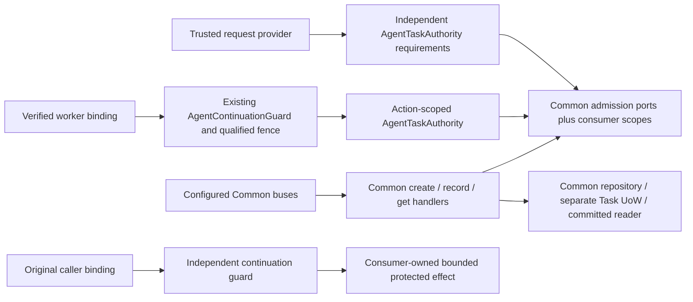

# Agent Task admission — slice A (unreleased)

TASK-00097 composes independent direct Agent Permissions and consumer-owned scope with Common's actual Task
creation, producer transition and complete current-state Query. It adds no Task lifecycle, persistence adapter,
executor, scheduler, grant, protocol endpoint or advertised partial MCP Tasks extension. Input answering,
cancellation, removal, full MCP serving and live Task output retain their later TASK owners.

## Contracts and ownership

Policy lives in `Application/AccessControl/Agent/Task`. All three admission implementations satisfy the actual
Common `Application/Mcp/Task/Service` ports. Configure them on Common handlers, including alternate bus entry points;
a Tool-only check is insufficient.

| AccessControl type | Purpose |
| --- | --- |
| `AgentTaskAuthority::fromRequest()` | One nonempty conjunctive list of canonical `PermissionName` values over the trusted request-owned `CurrentAgentPrincipalProvider`, signed request and safe correlation ID. No human principal or copied principal factory. |
| `AgentTaskCreationAdmission` / `AgentTaskCreationScope` | Independent creation Permission and authoritative original-operation/producer/scope decision before lookup, payload comparison or mutation, including retries. |
| `AgentTaskUpdateAdmission` / `AgentTaskUpdateScope` | Independent producer Permission and current trusted producer/Task/operation association, before concealed lookup on each attempt. The supplied producer string is not producer authentication. |
| `AgentTaskReadAdmission` / `AgentTaskReadScope` | Independent Permission and current sharing over **all** state, messages, input definitions, results, errors and metadata. Another independently authorized Agent may read; creator identity is not required or sufficient. |
| `AgentTaskAuthority::duringContinuation()` | Existing TASK-00088 guarded bounded action with an ephemeral authority usable only during that action. Supports trusted worker handoffs without signed-request replay or retaining a provider singleton. |
| `AgentTaskContinuationScope` | Delegates current scope and retains the fresh guard principal. A qualified fence must recognize this wrapper and fence the exact `getScope()` consumer policy and every participating writer. It is not an authority factory. |

Permission names are consumer configuration, not newly seeded names or implicit ADMIN grants. Examples below use
`TASK_CREATE`, `TASK_UPDATE`, `TASK_READ` and `TASK_CONTINUE` only as illustrative independent requirements. Multiple
requirements remain conjunctive; empty, associative or non-`PermissionName` configuration throws `LogicException`.
Consumers choose separate requirements/instances for each operation. Do not inject a creation authority as the
read authority just because it is already available.

Scope ports receive selectors and an actually authenticated Agent snapshot. They must consult authoritative
consumer relationships, trusted producer association and original-operation policy. They grant nothing from IDs,
metadata, capability declarations, Role labels, handle possession, prior success or current Tool availability.
Scope must not create business Commands/events, renew TTL or mutate a business aggregate while checking. Unavailable
policy throws, rather than returning permissive scope or a fabricated successful empty result.

## Runtime ownership



Source anchors: [authority](../src/Application/AccessControl/Agent/Task/AgentTaskAuthority.php),
[scope wrapper](../src/Application/AccessControl/Agent/Task/AgentTaskContinuationScope.php),
[original guard](../src/Application/AccessControl/Agent/Continuation/AgentContinuationGuard.php), and
[executable composition](../tests/Application/AccessControl/Agent/Task/AgentTaskAdmissionTest.php).
This maintained diagram's authoring source is the fenced Mermaid above; it describes slice A, not live MCP serving.

## Configure the real handlers and buses

These are composition excerpts, not a new service or complete bootstrap. The consumer supplies repositories,
separate Task UoW/committed reader, event dispatcher, server millisecond clock and actual scope implementations.

```php
use Fight\AccessControl\Application\AccessControl\Agent\Task\AgentTaskAuthority;
use Fight\AccessControl\Application\AccessControl\Agent\Task\AgentTaskCreationAdmission;
use Fight\AccessControl\Application\AccessControl\Agent\Task\AgentTaskReadAdmission;
use Fight\AccessControl\Application\AccessControl\Agent\Task\AgentTaskUpdateAdmission;
use Fight\AccessControl\Domain\AccessControl\Permission\PermissionName;
use Fight\Common\Application\Mcp\Task\CommandHandler\CreateTaskHandler;
use Fight\Common\Application\Mcp\Task\CommandHandler\RecordTaskStateHandler;
use Fight\Common\Application\Mcp\Task\QueryHandler\GetTaskHandler;

$createAuthority = AgentTaskAuthority::fromRequest(
    $provider, $signedRequest, $correlationId, [PermissionName::fromString('TASK_CREATE')]
);
$updateAuthority = AgentTaskAuthority::fromRequest(
    $producerProvider, $producerRequest, $correlationId, [PermissionName::fromString('TASK_UPDATE')]
);
$readAuthority = AgentTaskAuthority::fromRequest(
    $provider, $signedRequest, $correlationId, [PermissionName::fromString('TASK_READ')]
);
$create = new CreateTaskHandler(
    $taskRepository, $taskUnitOfWork, new AgentTaskCreationAdmission($createAuthority, $createScope),
    $payloadPolicy, $eventDispatcher, $millisecondClock
);
$update = new RecordTaskStateHandler(
    $taskRepository, $taskUnitOfWork, new AgentTaskUpdateAdmission($updateAuthority, $producerScope),
    $payloadPolicy, $eventDispatcher, $millisecondClock
);
$read = new GetTaskHandler(
    $committedTaskReader, new AgentTaskReadAdmission($readAuthority, $readScope), $payloadPolicy, $millisecondClock
);
$commandRouter->registerHandler($create::commandRegistration(), $create);
$commandRouter->registerHandler($update::commandRegistration(), $update);
$queryRouter->registerHandler($read::queryRegistration(), $read);
```

Use actual `CreateTask`, `RecordTaskState` and `GetTask` payloads through Common's configured buses. Common owns its
transaction; do **not** wrap it in an enclosing application DB transaction. The independent read repository need
not expose writes. Common's `ToolTaskPayloadPolicy` validates against the **retained original** Tool contract,
not an unrelated currently registered Tool. Supply its independent all-field safe-disclosure callback and constant
safe execution-error mappings. Admission is not payload sanitization.

Common checks creation/update admission within its serialized mutation boundary, including repeats, terminal,
expired and absent paths. It validates payloads and owns atomic state/version/retry/terminal winner behavior.
Queries use a committed coherent snapshot, then comparison and final independent whole-state disclosure checks.
They neither execute work nor commit, publish checking events, clean expired rows or renew retention.

### Comparison continuity and complete states

`AgentTaskReadScope::comparisonScope()` supplies Common's bounded case-sensitive reference (1–96 characters under
`TaskDefinition::reference`). Bind the admitted reader and **durable visibility epoch** across processes/reconnects.
Rotate after sharing/authority discontinuity, restoration or revoke/regrant. A handle, permission list or constant
shared by all readers is not such evidence. Without continuity, return a fresh valid opaque reference so Common's
safe restart semantics remain intact. The adapter checks read authority/scope before requesting this context;
Common performs its final scope/disclosure checks after callbacks and projection.

Allowed reads return Common's complete actual state, never a redacted/empty successful substitute. `working`,
`input_required`, `completed`, `failed` and `cancelled` remain coherent. Completed Tool `isError: true` is not a failed
Task with a safe JSON-RPC execution error. Original context remains retained, not publicly added to a safe event.
Common preserves actual TTL/absence/polling/revision metadata and finite encoded bounds: original operation context
8192 bytes, Task state 32768 bytes, stored aggregate 40960 bytes, plus its other input/projection limits. Limits
compose; individually valid components do not promise a valid aggregate at their combined maxima. Nothing truncates
protected content or fabricates partial success.

## Background producers and original caller continuation

Ordinary request authorities intentionally share the provider's one authenticated snapshot and nonce result.
They must not survive that request or be held as a worker singleton. For a bounded background report, reconstruct
a **producer** binding only through `AgentContinuationBinding::fromHandoff($trustedProducerVerifier)`, then:

```php
AgentTaskAuthority::duringContinuation(
    $producerGuard,
    $producerBinding,
    [PermissionName::fromString('TASK_UPDATE')],
    $currentProducerOperationScope,
    function (AgentTaskAuthority $authority) use ($composeProducerCommandBus, $recordState): void {
        // Configure the actual Common update handler's admission with this authority and current producer scope.
        $commandBus = $composeProducerCommandBus($authority);
        $commandBus->execute($recordState);
    }
);
```

The callback executes synchronously under TASK-00088's existing guard; saving the supplied authority does not
permit later use, even after callback failure. A qualified consumer fence must explicitly support
`AgentTaskContinuationScope`, resolve its exact `getScope()` target and coordinate all underlying authorities;
unknown scope wrappers must fail before invocation. The wrapper creates no lock implementation. Maintain the
existing global lock order and support only bounded synchronous callbacks. A callback that merely queues work
authorizes no later execution. No new production all-writer synchronization is supplied.

When the worker performs protected **original operation work**, independently invoke the original caller's existing
`AgentContinuationGuard::run()` around the actual effect using the original caller binding, operation requirements
and current caller/Task scope. Producer authentication/reporting cannot replace that admission. If both are required
at one boundary, compose the guards with the consumer's qualified global fence order; do not infer reentrant locking.
Reporting an already obtained outcome may be independently allowed even when continuation is refused.

Both paths retain TASK-00088's fixed original five-minute provenance window, fresh current Agent/credential/direct
Permission/cohort/scope checks, sanitized pre-action rejection, original credential binding and primary action-fault
truth. Handoff reconstruction never refreshes authentication age, adopts a new credential or consumes a nonce.
Revocation, rotation, Permission/definition/scope changes and resolver faults deny the next protected action. There
is no guarantee of permission stability after an ordinary final read check, send-spanning lock, in-flight interruption,
rollback of prior effects, stopped worker or exactly-once external execution. See the full
[continuation contract](agent-continuation-authorization.md) for lifetime, writer and fault obligations.

## Denial, faults and durable truth

- Genuine authentication/current-authority refusal and unmet direct requirements return denied admission. Malformed
  authoritative snapshots and operational authentication failures propagate their existing safe typed exception.
- Scope faults propagate to the owning safe error boundary, not denied/missing success. Common create/update denial
  throws `TaskRejected`; denied read returns Common's concealed `null`, also used for true unavailable/expired state.
  A denied comparison-context request throws `TaskRejected`; it never returns a comparison token.
- Common owns `TaskConflict`, storage failure/uncertainty and `CommittedTaskDispatchFailed`. A committed change with
  failed postcommit publication remains committed. Exact retries do not dispatch twice or renew TTL. Lost commit
  acknowledgment needs independent committed reconciliation; dispatch acceptance/absence proves no commit outcome.
- Do not log raw scope/storage/action throwables, their causes, bindings, credentials, original arguments, payloads
  or private conflict material into generic facts/notices/diagnostics. Keep one redaction-aware reporting owner and
  the actual MCP-specific safe envelope; HTTP/JSend is not a Task protocol fallback.

## Qualification and limits

The first sufficient tagged Common API is **v1.5.0**, source
`06fb5cd3720af9cf8295198f74040d95b64c5155`; the manifest already requires `^1.5.0`. Supplier independent acceptance and
release adoption are recorded in [the contract inventory](common-contracts.md). Exact-minimum and ordinary feature
lanes, lock/source/runtime identity, focused/full gate and exact owned coverage belong to the canonical TASK-00097
Work handoff. DBAL `^4.4` is a **development-only** dependency for actual Common SQLite adapter/transaction tests;
no persistence adapter or Doctrine runtime dependency is added to the package's production policy.

`AgentTaskAdmissionTest` uses real AccessControl authentication/exact Permission resolution and real Common handlers,
routing buses, payload policy, schema, DBAL repository and transaction over SQLite. It covers independent Agent
read sharing, scope denial/faults, complete five-state reads, input-state seeding through Common, original context,
TTL, exact payload bound, retry/conflict/terminal winner, rollback, lost actual commit acknowledgment with a fresh
connection, postcommit dispatch failure and current worker reporting. Existing continuation tests separately prove
controlled all-writer schedules and binding validity. These are not real consumer persistence, cryptography, sharing,
durable visibility history, authority writer/lock, queue-integrity, multi-process worker or external-effect qualification;
SQLite evidence does not certify MySQL/PostgreSQL. Consumers must qualify their exact components and alternate entry
points. Independent Review and nonvisual QA remain required; no package acceptance or combined release is self-issued.
