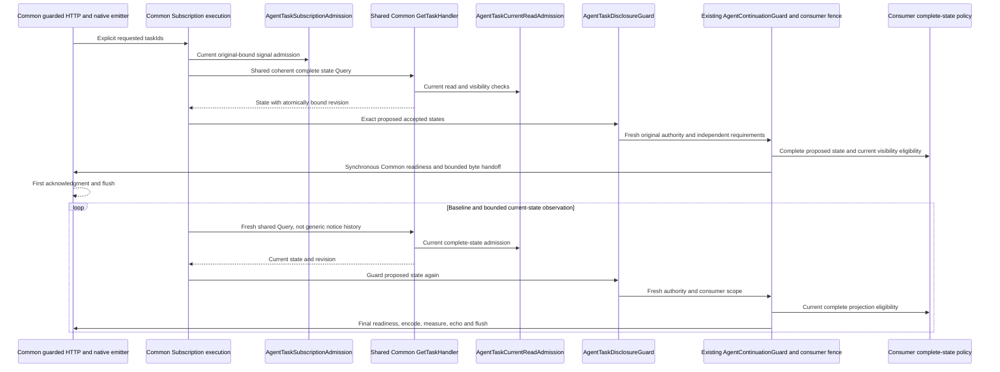

# Optional complete Task notifications

Unreleased [TASK-00102](../planning/tasks/00102-TASK.md) composes the actual **Common v1.5.0** Task/live APIs,
tagged source `06fb5cd3720af9cf8295198f74040d95b64c5155`. The existing `^1.5.0` minimum suffices; see the
[supplier inventory](common-contracts.md). This is optional package composition, not production qualification.
Ordinary [Task serving](agent-task-authorization.md#complete-guarded-mcp-serving--slice-e), input/cancel and polling
remain usable without Subscriptions, generic notice storage, Mercure or a live worker.

## Current authority and explicit composition

Keep one trusted request-local `AgentContinuationBinding::fromRequest()` from the ordinary authenticated provider.
It retains original Agent/credential/revision/provenance, never a signature or reusable nonce. Reconnect independently
authenticates a new request. Full-state read, listening and Task-signal requirements are separately configured,
nonempty conjunctive canonical `PermissionName` lists. Illustrative names below are consumer grants, not new seeds.

- `AgentTaskCurrentReadAdmission($readAuthority, $readScope)` consumes the existing original-bound
  `AgentNoticeAuthority`, configured with independent complete Task-read requirements. Despite its historical name,
  that authority resolves Agent/credential/current direct Permissions, not notice/catalog permissions. It checks
  current consumer `AgentTaskReadScope` and visibility context through the same actual Common `GetTaskHandler` used
  for polling and live. No opening principal snapshot survives as ongoing authority.
- Pass that admission as `AgentTaskRequestAdmission`'s state admission. The guarded HTTP boundary selects it for
  `tasks/get` and `subscriptions/listen` only after Common transport/protocol/mirror validation. A request-snapshot
  `AgentTaskReadAdmission` alone cannot enable live state. Creation acknowledgment remains independently admitted.
- `AgentTaskSubscriptionAdmission($subscriber, $signalAuthority, $disclosurePolicy, $genericAdmission)` adds exact
  `taskIds` signal checks. Configure signal authority with listening **and** independent Task-signal Permissions.
  Optional existing `AgentSubscriptionAdmission` handles generic families for the identical subscriber only; no
  generic notice or catalog grant can authorize Task IDs or bodies. A Task ID is not a Resource URI here.
- `AgentTaskDisclosureGuard($subscriber, $continuationGuard, $binding, $requirements, $disclosurePolicy)` implements
  Common's mandatory synchronous action seam. Configure requirements for listening, Task signal **and** complete
  state. It creates a fresh `AgentTaskDisclosureScope` for the exact proposed states and invokes the existing
  `AgentContinuationGuard::run()`. No second engine, lifecycle store, policy snapshot or send queue is introduced.

Compose all four ordinary real handlers using `AgentTaskServing`, with the same request admission in its
`GetTaskHandler` and guarded endpoint. Then use its **identical** `tasks()` instance:

```php
$subscriptions = new McpSubscriptions(
    $trustedGenericSourceQueryBus,
    $dedicatedCommonTrackingStore,
    $taskSubscriptionAdmission,
    $completeTrustedTrackingSelection,
    tools: false,
    resources: false,
    maxFrameBytes: 8192,
    taskCapability: $serving->tasks(),
    taskDisclosureGuard: $taskDisclosureGuard
);
$capabilities = $serving->capabilities(
    $serverInfo, $toolRegistry, $requestProvider, $signedRequest, $correlationId,
    $discoverySecret, $explicitToolPermissionBindings,
    subscriptions: $subscriptions
);
```

Imports are Common `Application\Mcp\Subscription\McpSubscriptions` and AccessControl
`Adapter\Mcp\Task\Agent\AgentTaskServing`; the admission/policy types above live under
`Application\AccessControl\Agent\Task` except the thin `Adapter\Mcp\Subscription\Agent` presenter.
Common rejects missing/mismatched Task capability identity. Task-only composition never queries `RecoverNotices`;
mixed enabled/requested/accepted generic families use the independently protected existing source and its continuity
rules. No broad source grant is manufactured for a recipient. Tracking selection must cover **all** Task scope and
requested/accepted IDs, not an unrelated narrower notice scope. Subscriber inspection remains independently protected.

## Consumer policy and required guard obligations

`AgentTaskDisclosurePolicy::allowsSignal()` admits the entire Task signal/ID. `allowsState()` admits the exact complete
proposed state, all status/input/result/error/retention/revision fields and current relationships. It must reject a
projection from an incompatible visibility epoch, even if the caller can now read a different complete view. The
policy receives proposed data, **not authority**. No redacted successful Task is permitted. Throws are operational
failure, not healthy absence. `AgentTaskDisclosureScope::policy()` identifies the consumer policy to its composite
fence, analogous to the existing continuation-scope association.

The existing `AgentContinuationFence` supplied to the guard must qualify synchronization for original authority,
credential, Permission definitions/assignments and **every** consumer scope/field/epoch writer, including reentrant
writers, through Common's synchronous action. Unsupported participation must reject before invoking it. The action
runs exactly once on the calling Fiber, includes Common's final technical readiness and native bounded echo/flush,
and must not be saved, deferred, retried, yielded or merely enqueued. Release on all exits and qualify finite lock,
SQL and write timeouts. Common enforces its action-invocation shape; a post-action fault cannot retract output.
No transaction or fence spans the live wait.

These are **upstream consumer composition obligations**, not a new AccessControl production lock implementation or
an acceptance claim that every application writer is synchronized. Controlled fixtures prove package wiring.
AccessControl adds no new all-writer synchronization and does not promise prevention of every Permission change
between its final check and sending. A composition lacking the required consumer fence is unsupported, never a
reason to install an allow-all guard or weaken Common's contract. Ordinary subscription/publication check-before-send
limits and TASK-00088's existing continuation contract are unchanged.

## Runtime flow

Existing implementation, source revision: **WORK-CANDIDATE** (pinned after verification in the Work handoff).
Solid arrows below are calls; dashed arrows are returned state/frames. This is a bounded runtime view, not a static
outward dependency: Application policy depends only on supported Application/Domain contracts.



Trace: `AgentTaskServing::{tasks,capabilities}` binds identical Common capability/registry instances;
`AgentTaskRequestAdmission::allows` selects current state purpose; `AgentTaskSubscriptionAdmission::allows` delegates
current signal authority; `AgentTaskCurrentReadAdmission` supplies Query read/context checks;
`AgentTaskDisclosureGuard::run` → `AgentContinuationGuard::run` → `AgentTaskDisclosureScope::isAllowed` checks all
proposed states before the action. Common `McpSubscriptionExecution::{accepted,task,disclose}` and its native emitter
own sourcing, scheduling and byte delivery. The diagram abbreviates dedicated tracking renew/close, errors, generic
mixed families and bootstrap. It proves neither deployed writer participation, buffering safety nor client receipt.

## Wire, ordering, finite bounds and recovery

Each request declares `clientCapabilities.extensions["io.modelcontextprotocol/tasks"]: {}` in standard `_meta`.
Request `notifications.taskIds`, a list of at most **16** 32-lowercase-hex IDs (duplicates count structurally, then
collapse). No Task-notification capability flag exists. Common acknowledges only supported/requested/permitted IDs
first, concealing denied/missing/expired/withheld reasons. Baseline is freshly sourced after acknowledgment, including
already-terminal state and changes during opening. Native frames preserve exact string/integer subscription IDs;
correlation, recipient, role, handles and prior acknowledgments grant no continuing authority.

`notifications/tasks` has flat complete DetailedTask params, not the get envelope. Public outstanding input forms
remain complete; private runtime definitions/answers do not become public forms. Input acceptance and cancellation
intent do not imply consumption, worker stop, rollback or a terminal outcome. Protected state never enters general
notices, subscriber context or indiscriminate Mercure output. Tracking retains only protected technical context,
requested/accepted IDs and freshness, not state, answers, revisions or request IDs. It implies no connectivity/receipt.

Shared get/live `_meta["org.fight/taskRevision"]` binds the same immutable committed Task state. For the **same Task
and equal scope**, bytewise compare the entire fixed-width value: larger replaces, equal is duplicate, smaller is
stale even if it arrives later or timestamps are equal. Different/missing/malformed scope/value is incomparable:
stop the old merge context, independently reauthorize/get and listen again, ignoring delayed old-context frames.
Never compare across visibility epochs or use timestamps, arrival time, global counters or revision gaps as private
activity evidence. Consumers supply durable trustworthy caller/visibility epochs through `AgentTaskReadScope` and
rotate after any changed/restored/regranted eligibility. No continuity means restart, not guessed history.

Common owns coalescing/current-state Queries, at most 16 accepted IDs, 12,000 cooperative work checks, a 1–120-second
lifetime (default 30), 10,000–1,000,000-microsecond waits (default 200,000), no unbounded latest-state queue and its
existing finite tracking capacity/freshness. Final JSON-RPC **plus SSE framing** is limited to 256–65,536 bytes
(default 16,384). Include nested content, escaping/multibyte data, revision and subscription metadata. The 8,192-byte
example fits the native emitter's ordinary frame read. Stored-valid oversized states stop, never truncate or emit a
partial successful Task. Ordinary get additionally measures central server metadata under its own response budget.

Denied/unavailable/incomparable state, source/policy/tracking/framing/transport faults close the whole stream without
healthy completion or private diagnostic text. Common owns one redaction-aware diagnostic sink. Technical tracking
writes are not business mutation/events. Disconnect/abrupt death neither cancels work nor renews retention, consumes
answers, replays effects or proves rollback. A fresh independently admitted get/listen recovers **current retained
permitted state**, not every missed intermediate notification. Absence/expiry fabricates no outcome.

Use Common's native emitter, output buffering/compression disabled, no Content-Length and no generic read-then-send
buffering substitution. One synchronous byte handoff is not atomic TCP delivery or receipt. Slow/paused readers may
outlive freshness; PHP cannot preempt blocked I/O or guarantee instant disconnect detection. Consumer DB/crypto,
all-writer races, policy epochs, proxy/SAPI buffering, worker lifetime and client merge/receipt require separate
qualification. Canonical Work evidence records actual minimum/ordinary locks, native runtime, focused/full checks,
exact coverage and limitations; independent Review and behavioral QA remain required.
