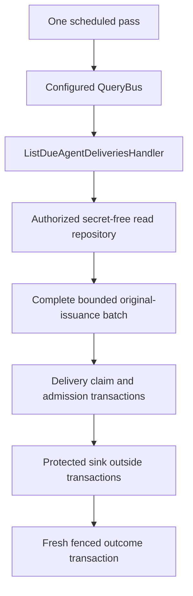

# Agent worker contracts (Unreleased)

TASK-00144 refreshes delivery, revocation, scheduler recovery and material maintenance at their current capability
homes. This is a breaking pre-v1 composition/failure correction, not a release, consumer implementation or a new
source of authority. Existing void issuance Commands and independent outcome Queries remain unchanged.

## Current owned boundary

Paths below are relative to `Application\AccessControl`. Native results remain exact; no uniform result DTO,
replacement transaction API or generic Unit of Work supplier is required.

| Declaration | Current home | Result / meaningful optional state |
| --- | --- | --- |
| `AgentCredentialLifecycleService` | `Agent\Credential` | `revoke()` remains void; absence and current-state conflict are intentional Application failures. |
| `AgentCredentialDeliveryService` | `AgentCredentialOperation\Delivery` | One safe `AgentDeliveryResult`; no secret, cause or provider diagnostic. |
| `AgentDeliveryRecoveryService` | `AgentCredentialOperation\Delivery` | One bounded `array<string, AgentDeliveryResult>` keyed by original delivery ID; `nextRunAt()` returns a trusted-clock instant. |
| `AgentCredentialInvocation` | `AgentCredentialOperation\Delivery` | Exact issuance plus sensitive original bytes only for the fixed sink; redacted debug and prohibited serialization. |
| `AgentDeliveryResult` | `AgentCredentialOperation\Delivery` | Closed string-backed coordination outcomes, not activation/use authority. |
| `AgentCredentialReceiptLookup` | `AgentCredentialOperation\Delivery` | Exact durable receipt or authoritative null; failed lookup is not absence. |
| `AgentCredentialSink` | `AgentCredentialOperation\Delivery` | Outside-transaction staging returns a receipt; verification returns Boolean attestation, not secret material. |
| `AgentDeliveryAuthorization` | `AgentCredentialOperation\Delivery` | Read-only discovery is void; transactional admission returns worker/revision-bound authority and expiry. |
| `AgentDeliveryDecipher` | `AgentCredentialOperation\Delivery` | One sensitive invocation bound to the exact original issuance. |
| `AgentDeliveryMaintenanceService` | `AgentCredentialOperation\Maintenance` | Rewrap, expiry and cleanup each return one `AgentMaintenanceResult`. |
| `AgentMaintenanceResult` | `AgentCredentialOperation\Maintenance` | Closed string-backed outcomes; unchanged and cleaned do not grant delivery or key retirement. |
| `AgentCredentialCleanup` | `AgentCredentialOperation\Maintenance` | Void only after durable erasure/tombstone confirmation for the original tuple. |
| `AgentDeliveryRewrapper` | `AgentCredentialOperation\Maintenance` | Protected material at the requested writable key version, preserving original bytes and associated data. |
| `AgentMaintenanceAuthorization` | `AgentCredentialOperation\Maintenance` | Read/accounting admission is void; transactional maintenance returns independent current authority. |

## Configured scheduler dispatch

Inject the consumer's configured Common `QueryBus` into `AgentDeliveryRecoveryService`, not a QueryHandler.
Register `ListDueAgentDeliveries` with its actual `ListDueAgentDeliveriesHandler` on that bus. The handler retains
TASK-00134's read-only selection/authorization semantics and its narrow read repository. There is no shadow bus,
Event dependency, new issuance, caller retry or unbounded refill loop.

Common's supported bus currently returns `mixed`. This worker validates that dynamic boundary once before any
delivery: a bounded list of confirmed operation Views, exact requested scope/destination and unique delivery IDs.
A malformed batch fails wholly, never as empty/partial work. Native element/binding checks are **not** generic
Query-result inference. TASK-00144 owns this necessary caller adoption once; TASK-00128 still owns the upstream
payload/message/registration/result typing relationship and its eventual qualified adoption. No unchecked cast,
local concrete-result annotation or bypass is used to pretend that guarantee exists.

Real routing/configuration faults and unexpected selection failures raise safe `AgentOperationReadFailed`.
Deliberate discovery `UNAUTHORIZED`, `UNAVAILABLE` and supported-marker refusal retain their existing reason contract.
A successful empty selection is valid. Selection never admits a delivery; every selected item goes through fresh
worker authority and the original claim/admission/outcome path. Call `nextRunAt()` after a successful or failed pass.

## Failure ownership and containment

Delivery and maintenance retain their safe enum containment: unknown storage/provider faults yield `UNAVAILABLE`,
not fabricated refusal, deferral, not-found or successful empty work. A failed lookup or wrong returned key/Agent
identity has no business-refusal intent. Same-key wrong destination remains concealed; caller-supplied wrong delivery
correlation remains rejected. Among external storage ports, only an actual expected-state writer supplies
conflict/contention meanings; owned Domain claim/admission decisions retain their own reasons.
Authorization ports supply only their documented denial/unavailability and, for maintenance, closed-target-key
conflict. Capability lookup cannot invent claim contention or caller denial. Trusted Clock evaluations supply time,
not authority, contention, version refusal or commit evidence. Their faults remain internal `UNAVAILABLE`, including
when sampling authorization time; the provider catch encloses only the actual authorization call.

Transaction status/start failures likewise remain internal `UNAVAILABLE`, not business refusal or deferral. The
owned callback retains its exact primary throwable through the UoW boundary, even if transaction mechanics fail
while propagating it. Actual qualified authority, Domain and expected-state writer refusals keep their meanings.
A completed callback takes precedence as `INDETERMINATE` when acknowledgement fails, whether its effects ultimately
committed or rolled back. This meaning requires the worker's own invocation-local completion evidence, not merely
an exception class from a collaborator. Foreign uncertainty from authorization, reads, writes, keys or cleanup
remains `UNAVAILABLE`; external erasure alone does not prove an uncertain database commit. Native mixed results
and local callback annotations do not change this distinction.

The decipher and rewrapper deliberately classify temporary failure, permanent original-key loss and corrupt material.
Only those providers own key/integrity classification. A returned invocation must match every original issuance field;
a broken return promise is unavailable, not evidence that the persisted original copy should be destroyed. A rewrap
must return the requested target version. The sink/receipt/cleanup boundaries instead own temporary availability,
unsupported sink and invalid receipt/binding. They cannot report delivery-key loss as a reason to retire ciphertext.
A cooperating rewrap transaction/key-use fence retains deliberate `CONTENTION`; key providers do not invent
operation-authorization denial. Provider interpretation surrounds only the actual port work: trusted-time samples,
returned-binding validation and owned transitions remain outside that scope. An unrelated collaborator failure
cannot supply evidence for a provider outcome or discard valid original material. Confirmed claim/admission state
remains durable even when invocation cannot proceed. Approved transient provider containment remains distinct from
a confirmed outcome; no diagnostic-text/code guessing or chained raw cause is used.

Only the actual cleanup provider call maps temporary/unsupported capability to `RETRYABLE` and deliberate
exact-binding rejection to `REJECTED`; out-of-contract faults remain `UNAVAILABLE`. Delivery-failure exceptions
from authorization, capability, lookup, expected-state writes or pre-completion transaction work do not inherit
provider intent, including during expiry, which invokes no provider. A failure after the owned transaction callback
completes remains `INDETERMINATE`. Neither failure acknowledges cleanup. A physical effect may already
have happened before a lost response; retry only the same original tuple under fresh maintenance authority.

For already recorded delivery, verification only attests the original receipt: true remains `DELIVERED`,
authoritative false requires reconciliation, and any failed verification read is `UNAVAILABLE`. It cannot supply
caller refusal, deferral or commit uncertainty, rewrite history, or trigger materialization/restaging. Pending
provider calls retain their separate approved transient containment; neither path grants new issuance authority.

Revocation deliberately throws Common `ResourceNotFound` for authoritative absence and `StateConflict` for an
already-retired credential or lost expected-state replacement. Wrong lookup identity is internal. Its required
coupled retirement/audit transaction and post-commit throwing policy are unchanged: a secondary failure notifier
cannot replace the primary fault, and confirmed retirement cannot be inferred rolled back. Safe constant failure
evidence does not sanitize the rethrown throwable. Consumers retain safe response/log handling; Common's opt-in
safe HTTP composition distinguishes 404/409/internal 500 without publishing diagnostic messages or traces.

## Preserved transaction and recovery guarantees

- Original operation/scope/destination/delivery/Agent correlation and current delegated authorization remain required,
  including before concealed maintenance lookup. Authority that expired while its provider returned cannot admit
  that lookup or later effects.
- Claim, admission and outcome commit separately. Protected sink effects remain outside transactions; bounded
  rewrap remains inside its authorization/key-reference fences. An unconfirmed commit yields `INDETERMINATE`,
  never guessed rollback or permission to invoke.
- Expected attempt/revision/epoch, Agent/cohort/restoration/destination and retention fences remain authoritative.
  Stale workers cannot acknowledge a successor or revive cancelled work. Restart reconciles receipts before key
  access and never blindly restages from a recovered admission.
- Maintenance preserves original expiry, issuance/rewrap identity, key-reference semantics, retained keys and
  tombstones. Cleanup confirmation is separate from physical erasure. Historical receipts, Views and zero counts
  grant no future delivery, activation, use or physical key-retirement permission.
- Native UoW remains `mixed`. Local annotations describe every known owned callback return: delivery operation,
  revocation Event, maintenance result or the exact operation/authority admission tuple. There is no generic-return
  assertion over externally supplied bus data, redundant local-result validation or new transaction wrapper API.

## Evidence boundary

The default tests exercise real Common routing and safe HTTP composition, public worker/lifecycle behavior,
precise provider results and modeled durable restart/interleavings. Positive/negative static fixtures cover native
ports/results, optional receipts and wrong-purpose uses; they explicitly retain the bus's current `mixed` result.
The canonical TASK Work handoff owns exhaustive member/callback/caller dispositions, regression chronology,
supported-minimum/ordinary dependencies, exact coverage and complete gate evidence. Independent Review and
nonvisual QA remain required. Package doubles do not qualify real SQL, cryptography, sinks, cohort restoration,
activation/use, consumer adoption or deployment.
