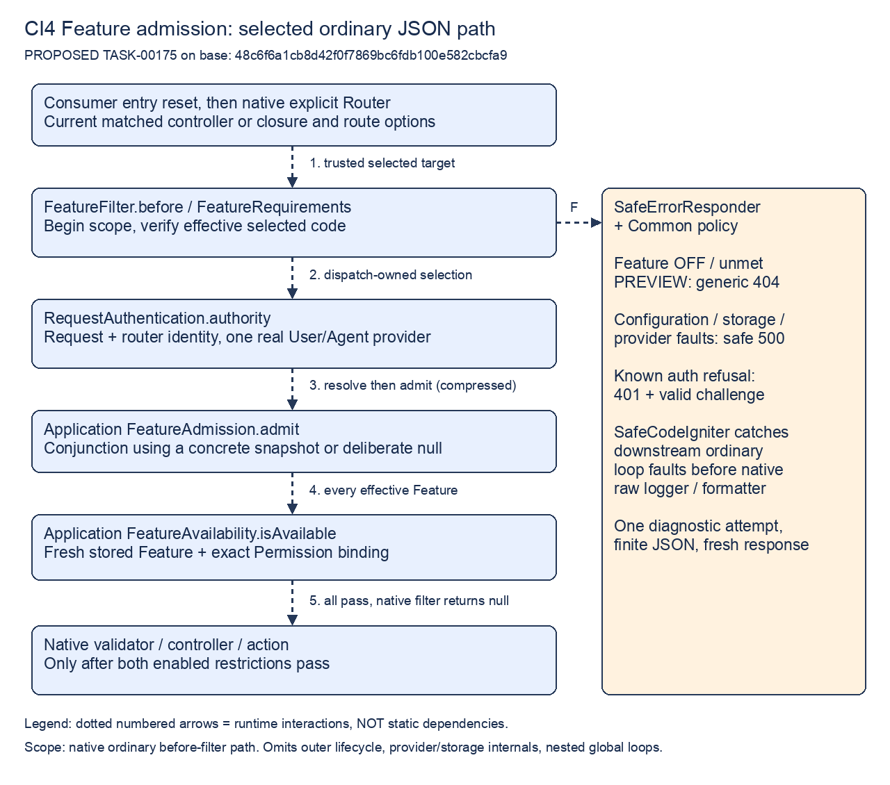

# CodeIgniter 4 Feature runtime view

PROPOSED TASK-00175 implementation candidate on base `48c6f6a1cb8d42f0f7869bc6fdb100e582cbcfa9`.
The canonical Work handoff records the candidate and its tested-content bridge. This bounded view supplements the
[owning composition guide](../codeigniter-feature-admission.md); it is not a whole class/dependency graph.

[Editable Python](runtime-flow.py) · [Open PNG](runtime-flow.png)

Dotted arrows are numbered runtime interactions, **not static dependency directions**. Layer ownership remains
Adapter → Application → Domain. The error box compresses response propagation, not a new inward error dependency.

| Arrow | Inspected source | Meaning |
| --- | --- | --- |
| 1 | [FeatureFilter::selectedAction/before](../../src/Adapter/Http/CodeIgniter/FeatureFilter.php), [FeatureRequirements::getReferences](../../src/Application/AccessControl/Feature/FeatureRequirements.php) | Consumer clears state before native routing; matched code and route-bound effective requirements must agree before authority/work. No controller is constructed for metadata. |
| 2 | [RequestAuthentication::begin/authority](../../src/Adapter/Http/CodeIgniter/RequestAuthentication.php) | Private request/router identity clears earlier attempts and selects one actual request provider across cooperating gates. |
| 3 | FeatureFilter::before → RequestAuthority::resolve → [FeatureAdmission::admit](../../src/Application/AccessControl/Feature/Admission/FeatureAdmission.php) | Compressed ordered hop to a concrete User/Agent snapshot or deliberate anonymous null, never a copied grant. |
| 4 | FeatureAdmission::admit → [FeatureAvailability::isAvailable](../../src/Application/AccessControl/Feature/Service/FeatureAvailability.php) | All effective requirements use fresh authoritative Feature settings and exact stored Permission bindings. |
| 5 | FeatureFilter::before, [native fixture](../../tests/Adapter/Http/CodeIgniter/NativeApplication.php) | Null permits later native validators/construction/action; a native Response short-circuits them. Independently selected Permission admission must also pass. |
| F | FeatureFilter::before, [SafeCodeIgniter::handleRequest](../../src/Adapter/Http/CodeIgniter/SafeCodeIgniter.php), [SafeErrorResponder::respond](../../src/Adapter/Http/CodeIgniter/SafeErrorResponder.php) | Ordinary Feature unavailability alone becomes generic 404. The unchanged Common-backed bridge owns one safe report/response and downstream interception, not the before-filter catch alone. |

Omitted: provider authentication/HMAC/nonce stores, repository internals, detailed Common fallback, full Permission
flow, earlier/bootstrap/required filters, send/shutdown, global reentrant loops, non-JSON entry points and installed
consumer composition. Source traces were inspected; an arrow is not execution, acceptance or security proof.
Native tests and independent reports own behavioral claims. Rendering uses local Python/Pillow with no network or
application effects; source and PNG are maintained together.
