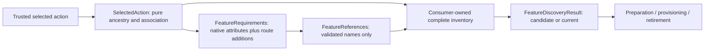

# Feature declarations and discovery

TASK-00170 extends the original v0.5.0 declarations with effective class/method requirements (unreleased).
This is metadata only; native HTTP admission and portable Permission declarations retain separate owners.

[TASK-00061](../planning/tasks/00061-TASK.md) supplies portable name-only metadata and inventory contracts. It does
not itself implement Feature storage, provisioning, availability checks, management or runtime enforcement.
[TASK-00062's atomic provisioning](feature-provisioning.md) consumes this contract, and
[TASK-00063's preparation validation](feature-preparation.md) checks complete candidate references against stored
Features and bound Permissions. [Runtime evaluation](feature-availability.md) is now implemented by TASK-00064;
[Permission reference guards](feature-permission-references.md), [management](feature-management.md) and
[current-reference retirement](feature-retirement.md) supply the remaining package operations. Their
[scenario/evidence inventory](feature-evidence.md) records each slice's independent technical acceptance and
behavioral QA, including TASK-00067's final lifecycle evidence.
The declarations are an additive public PHP API, not a release, supported partial feature-flag system or consumer
qualification. Declaration/discovery alone changes no persisted format, existing signature or OpenAPI schema;
provisioning has its own storage/schema assessment. [Preparation validation](feature-preparation.md) adds a
separate candidate query. No HTTP endpoint is implied.

## Name and declaration

`Fight\AccessControl\Domain\AccessControl\Feature\FeatureName::fromString()` accepts 1–128 ASCII characters:
lowercase letters/digits separated by single hyphens, starting with a letter. Examples: `a`, `dashboard`,
`new-checkout`, `agent-tools-v2`, `a-1`. `toString()` preserves the input. Empty/overlong names, uppercase,
leading digits, whitespace (including trailing newlines), non-ASCII characters, underscores, repeated/trailing
hyphens and normalization lookalikes throw `Feature\Exception\FeatureNameException`. Nothing is trimmed or converted.

Use `Fight\AccessControl\Application\AccessControl\Feature\Attribute\FeatureFlag` on classes and methods:

```php
use Fight\AccessControl\Application\AccessControl\Feature\Attribute\FeatureFlag;

#[FeatureFlag('checkout-family')]
#[FeatureFlag('shared-cart')]
final class Checkout
{
    #[FeatureFlag('new-checkout')]
    #[FeatureFlag('shared-cart')]
    public function submit(): void
    {
        // Consumer-owned operation; this Attribute does not intercept calls.
    }
}
```

Each declaration carries exactly one canonical name. Class and method declarations are repeatable, including valid
duplicates. Properties, constants, parameters and functions remain unsupported. Reflection must call `newInstance()`
on every Attribute to validate placement and arguments; `getArguments()` alone is insufficient. Missing, extra,
unknown or malformed arguments reject rather than disappearing behind a duplicate. The instance exposes
`getName(): FeatureName`, with no status, testing Permission, principal, configuration or any/all composition.
A consumer must instantiate every discovered declaration and reject invalid metadata, not silently skip it.
The [current payload catalog](public-payload-catalog.md) uses the same canonical FeatureName rule for public
Feature values. Its generated metadata does not extend this Attribute's targets or implement discovery/enforcement.

## Explicit registration and composition

The Application `Feature\Discovery\FeatureReferences` collection is immutable. It deduplicates by validated name, retains
first-reference order for inspection, and offers no Feature settings or authority. Set membership, not declaration
count, determines which Features are referenced. An ordinary collection alone claims no discovery completeness.

```php
use Fight\AccessControl\Application\AccessControl\Action\SelectedAction;
use Fight\AccessControl\Application\AccessControl\Feature\FeatureRequirements;

// Trusted router composition supplies the actually selected class/method, never client input.
$selected = SelectedAction::method(Checkout::class, 'submit');
$requirements = new FeatureRequirements($selected, 'agent-tools-v2', 'new-checkout');
$combined = $requirements->getReferences($selected);
// checkout-family, shared-cart, new-checkout, agent-tools-v2 (FeatureName values).
// These are conjunctive restrictions; no evaluation, provisioning or authorization has happened.
```

`SelectedAction` supplies pure class/interface and method ancestry once for independent declaration capabilities.
Requirements on every parent class and same-named parent method remain, including overridden and inherited actions.
Interface class/method promises accumulate too. `invokable(ClassName::class)` selects `__invoke`;
`closure($actualClosure)` supports explicit trusted registrations, with exact closure-object association.
`getReferences($actuallySelectedAction)` rejects a different class/method or closure, even for empty bindings.
Methods must resolve on a concrete class and be public, concrete, non-constructor/non-destructor methods. Magic
unresolved names, abstract/interface/trait targets and ambiguous native extraction cannot yield an empty fallback:
the caller must resolve a supported exact target or stop. Static public methods are supported explicitly. No
controller is constructed or invoked for inspection. Native route extraction and lifecycle timing are not supplied.

`SelectedAction::ancestry()` also exposes the same class/interface walk to consumer-owned inventory. Inventory
must include every applicable class and declared method, including overridden-parent declarations and explicit
registrations, not just `getMethods()` on a child. Validate unsupported placement too; invalid code cannot be
reported complete. Trait-imported selected methods use PHP's resolved method metadata; this does not infer a native
framework's routing/alias choice. No declaration means no Feature gate, **not** public Permission access.

Supported programmatic checks must be registered. Dynamic unregistered checks are unsupported. Consumers must
inventory all supported declaration paths; the package cannot discover an intended check a developer never declared.
Invalid raw registrations throw `FeatureNameException`; typed construction accepts only `FeatureName` values.



The [maintained ownership view](feature-references/README.md) shows the bounded new Application dependencies,
with editable Python, PNG and source/arrow traces; the flow above separately explains consumer composition.

The inventory arrow is consumer composition, not a package scanner. Permission declarations will consume the same
SelectedAction output independently; no Feature evaluator or discovery provider is required to traverse metadata.

## Complete discovery versus failed or incomplete discovery

Consumers implement `Fight\AccessControl\Application\AccessControl\Feature\Discovery\FeatureReferenceDiscovery`:

```php
public function discover(FeatureReferenceScope $scope): FeatureDiscoveryResult;
```

`FeatureReferenceScope`, `FeatureDiscoveryResult` and `FeatureReferences` are in the Application `Feature\Discovery` namespace.
The consumer selects the exact intended code and merges all its discovered and explicit references before returning:

- `FeatureDiscoveryResult::complete($scope, $combined)` only after complete, successful discovery.
- `FeatureDiscoveryResult::unavailable($scope)` for failed or incomplete discovery. This result accepts no partial
  names. Propagating a discovery/validation exception is also valid; callers must stop, not substitute an empty set.

A fully scanned code inventory with no references is a valid complete result using `new FeatureReferences()`.
It is not equivalent to a scanner failure, inaccessible module, malformed Attribute, invalid registration or
unfinished inventory. There is no fallback to “complete empty,” and no scanner diagnostics are carried in results.
Consumers may retain safe diagnostic details privately under their own logging policy.

Callers explicitly require the correct scope when extracting references:

```php
use Fight\AccessControl\Application\AccessControl\Feature\Discovery\FeatureReferenceScope;
use Fight\AccessControl\Application\AccessControl\Feature\Discovery\FeatureReferenceDiscovery;

function candidateReferences(FeatureReferenceDiscovery $discovery): array
{
    return $discovery->discover(FeatureReferenceScope::CANDIDATE)
        ->getReferences(FeatureReferenceScope::CANDIDATE)
        ->getNames();
}
```

`getReferences($requiredScope)` throws Domain `Feature\Exception\FeatureDiscoveryException` for unavailable
results or scope mismatch. Provisioning/preparation uses `CANDIDATE`; reference-safe deletion requires `CURRENT`.
The two scopes are not interchangeable: candidate code can remove a reference while currently running code still
uses it. Never relabel a result or reconstruct it under another scope to bypass that check. A fresh discovery of the
correct code is required. Consumers own code identity, scan coverage, explicit registry completeness and freshness;
these enums do not attest a deployment revision, fence running processes or certify undisclosed code. No filesystem
scanner, cache, environment access, database, framework integration or deployment coordination is supplied.

## Effects and follow-on boundaries

Declaration, registration, merging and reading discovery results are pure metadata operations. They perform no
Permission lookup/grant, persistence, transaction, event dispatch or access decision. A `FeatureFlag` declaration
cannot authorize a caller, enforce business Permissions, provision a Feature or prevent a method being called.
Consumers own scanning, composition, runtime enforcement, persistence and deployment wiring. TASK-00062 consumes
candidate discovery for provisioning; TASK-00063 adds [preparation validation](feature-preparation.md). TASK-00067 owns current-reference
[deletion](feature-retirement.md). Declaration/provisioning alone does not discharge its guards or certify a consumer.

## Executable package evidence

- `tests/Domain/AccessControl/Feature/FeatureNameTest.php`: exact name boundaries and rejection without normalization.
- `tests/Application/AccessControl/Feature/Attribute/FeatureFlagTest.php`: actual PHP reflection instantiation,
  invalid names/unsupported targets/arguments, valid class/method repetition and direct method invocation without implied enforcement. The deliberately invalid
  `Fixture/InvalidFeatureTargets.php.fixture` is loaded by PHP during those tests; it is not valid consumer source
  for static analysis. Runtime execution, not source matching, proves rejection.
- `tests/Application/AccessControl/Feature/Discovery/FeatureReferencesTest.php`: discovered/explicit merge, duplicate identity,
  immutable inputs and returned arrays, empty collections and invalid registration rejection.
- `tests/Application/AccessControl/Feature/Discovery/FeatureDiscoveryResultTest.php`: both scopes, complete empty/nonempty,
  partial/empty failed or incomplete scans, invalid native/explicit metadata and wrong-scope rejection.

- `tests/Application/AccessControl/Feature/FeatureRequirementsTest.php`: selected inherited/overridden/invokable/
  closure forms, parent accumulation, association mismatch, validation before deduplication and no construction.
- `tests/Application/AccessControl/Feature/Conformance/EffectiveFeatureDiscoveryTest.php`: class/repeated/parent/
  overridden/registered inventory through actual preparation, provisioning and retirement handlers.

The controlled test discovery implementation scans an already-selected class/object and fixed code scope; it does not prove a real codebase
was fully scanned or that a consumer selected the correct running deployment. Consumer qualification must exercise
its own scanner, invalid declarations, inaccessible code, explicit registry, code identity and candidate/current
selection before treating discovery as evidence. No screenshots are needed for these nonvisual PHP contracts.
