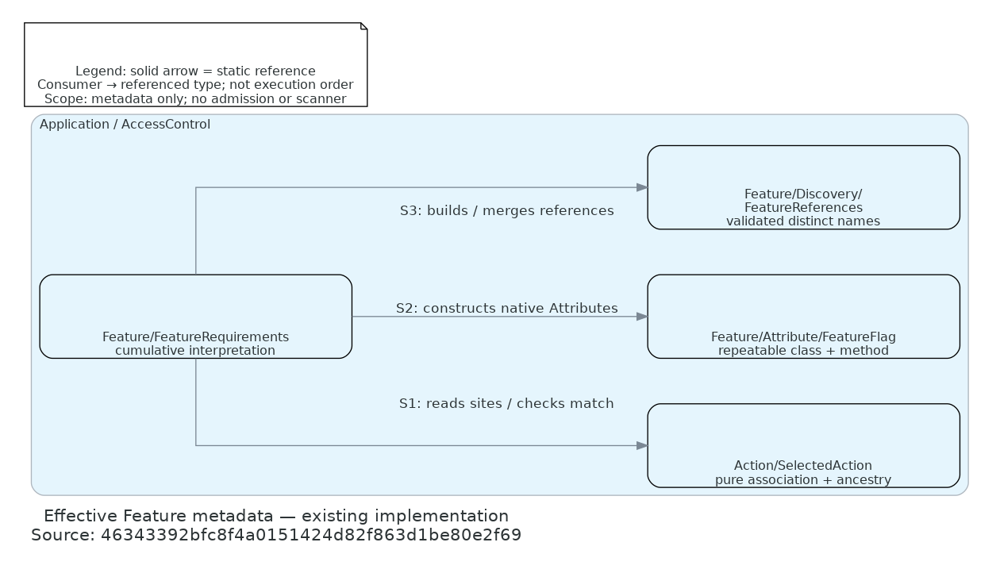

# Effective Feature metadata ownership

Existing implementation at source revision `46343392bfc8f4a0151424d82f863d1be80e2f69`.
This bounded static view explains the new pure selected-action owner and Feature-specific interpretation;
see the owning [declaration/discovery guide](../feature-references.md) for the separate inventory flow.

[Editable Python source](declaration-ownership.py) · [Open PNG](declaration-ownership.png)

## Source and arrow traces

All source links below refer to files inspected at the full source revision above. Retrieve that version with
`git show 46343392bfc8f4a0151424d82f863d1be80e2f69:PATH`. Documentation closeout leaves those source files unchanged.
Paths are relative to the repository root; linked files below resolve from this document.

| Owner / arrow | Source and observed meaning |
| --- | --- |
| SelectedAction | [Action/SelectedAction.php](../../src/Application/AccessControl/Action/SelectedAction.php): `method`, `ancestry`, `closure`, `getDeclarations`, `assertMatches` supply pure metadata and exact association; no Feature dependency. |
| FeatureRequirements / S1 | [Feature/FeatureRequirements.php](../../src/Application/AccessControl/Feature/FeatureRequirements.php): constructor reads `getDeclarations`; `getReferences` invokes `assertMatches`. Solid consumer-to-type dependency, not ordered runtime flow. |
| FeatureFlag / S2 | [Feature/Attribute/FeatureFlag.php](../../src/Application/AccessControl/Feature/Attribute/FeatureFlag.php): repeatable class/method native Attribute. FeatureRequirements filters by its class and calls reflection `newInstance()` before deduplication. |
| FeatureReferences / S3 | [Feature/Discovery/FeatureReferences.php](../../src/Application/AccessControl/Feature/Discovery/FeatureReferences.php): FeatureRequirements constructs native-name references and merges `fromStrings` registrations. Each raw registration validates before the effective set deduplicates. |

## Scope and limits

Solid directed arrows mean static references from consumer to referenced type, not execution order. Nodes show
real Application owners under `Fight\AccessControl\Application\AccessControl`; directory fragments are relative
to that namespace. Only these three important references are shown, not the whole graph. Domain FeatureName,
PHP reflection and explicit trusted routing are omitted to keep the new ownership boundary readable. There are
no implied inheritance, implementation or runtime-call arrows.

Consumer-owned complete inventory separately reuses `SelectedAction::ancestry` and the scoped discovery contract;
the package fixture is not a production scanner. Preparation/provisioning/retirement, repositories, evaluator,
HTTP admission and future Permission consumption are intentionally outside this static view. No principal,
controller construction, access decision or business effect is implied. Source traces and rendering do not prove
correctness, security, runtime ordering, independent acceptance or consumer qualification.

## Rendering

Rendered with the already available `fight-agent-os-diagrams:latest` image, without installing tooling or starting
provider services: one disposable, network-disabled container in the existing task project, with this feature
directory mounted at `/docs` and `python /docs/declaration-ownership.py`. The image provides Python Diagrams,
Graphviz and DejaVu Sans. Actual versions, image identity, render output and image inspection are retained in the
TASK-00170 Land evidence; this renderer is documentation tooling, not a product gate or sandbox guarantee.
