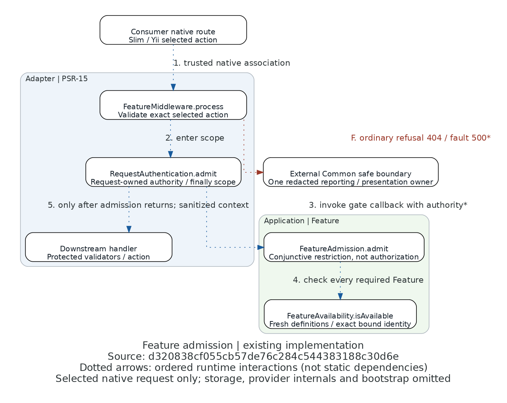

# Feature admission runtime view

Existing implementation at `d320838cf055cb57de76c284c544383188c30d6e` (the accepted Feature
implementation integrated with declaration-only Permission metadata). This supplements the maintained sequence
in the [owning guide](../http-feature-admission.md), not a complete framework or class graph.

[Editable Python](runtime-flow.py) · [Open PNG](runtime-flow.png)

All arrows are dotted, numbered runtime interactions, **not static dependency arrows**. The layout shows ordered
calls plus failure propagation; it does not imply that Application depends on Adapter or Common presentation.

| Arrow | Source trace at the revision above | Meaning |
| --- | --- | --- |
| 1 | [FeatureMiddleware::process](../../src/Adapter/Middleware/Psr15/FeatureMiddleware.php), first try block; [native fixture](../../tests/Adapter/Middleware/Psr15/NativePipeline.php) | Trusted native selector and supplier verify exact action association before authentication. |
| 2 | FeatureMiddleware::process → [RequestAuthentication::admit](../../src/Adapter/Middleware/Psr15/RequestAuthentication.php) | Enter the private request-identity scope; incoming copied context is not authority. |
| 3 | RequestAuthentication::admit invokes FeatureMiddleware's callback → [FeatureAdmission::admit](../../src/Application/AccessControl/Feature/Admission/FeatureAdmission.php) | Compressed callback hop: the gate resolves actual authority to a supported snapshot or deliberate null before inward admission. Empty requirements select no authentication. |
| 4 | FeatureAdmission::admit → [FeatureAvailability::isAvailable](../../src/Application/AccessControl/Feature/Service/FeatureAvailability.php) | Check every required Feature freshly, preserving exact stored binding identity and captured grants. |
| 5 | RequestAuthentication::admit → handler::handle | Only after successful admission, forward sanitized context and finally remove active state after downstream completion or exception. A cooperating Permission gate can still deny. |
| F | FeatureMiddleware::process and FeatureAdmission::admit; [safe composition guide](../http-permission-admission.md) | Ordinary unavailability alone becomes generic 404. Operational faults become safe 500; genuine authority authentication refusal retains typed 401/challenge behavior. Common surrounds the pipeline and reports once; the arrow is propagation, not a direct renderer call. |

Scope: real separately qualified Slim/Yii fixture paths, shared request scope and inward Feature restriction.
Omitted: provider internals, cryptography/nonce stores, repositories/transactions, detailed Permission gate ordering,
Common fallback internals, eager bootstrap, other native adapters and consumer installations. Source traces were
inspected, not inferred from layout. This image proves neither runtime execution nor consumer safety; the native
behavioral tests and independent reports own those claims. No proposed behavior is depicted.

The renderer uses Python Diagrams and Graphviz, writes adjacent PNG with `show=False`, and performs no application
operations or network fetch. Generated DOT is scratch rather than a maintained artifact.
