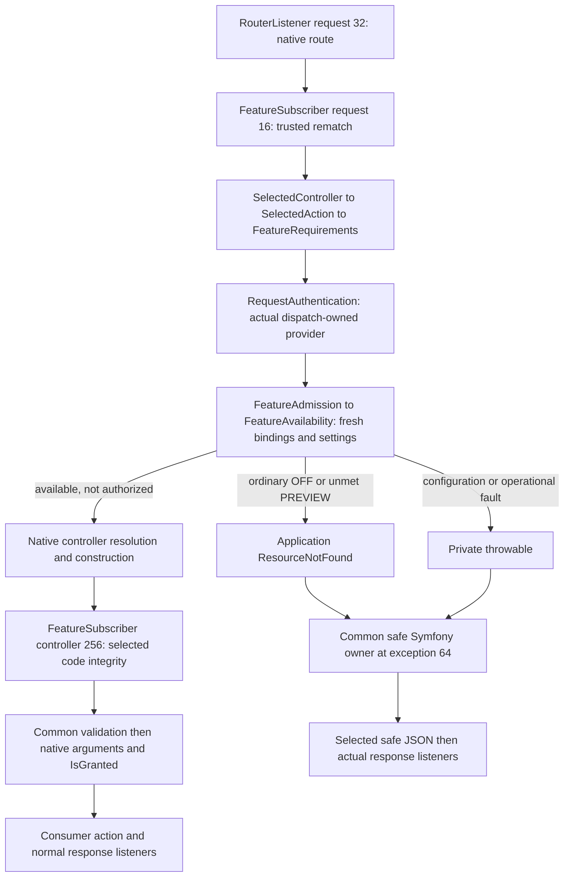

# Optional Symfony Feature admission

Select `Adapter\Http\Symfony\EventSubscriber\FeatureSubscriber` explicitly, independently of
[PermissionSubscriber](symfony-permission-admission.md). It restricts availability; **ON never authorizes an action**.
It installs no routes, firewall, services, grants, scanner, persistence or business checking message/transaction/audit.
Consumer authentication's existing session/nonce effects remain separate. This qualifies HttpKernel components,
not every FrameworkBundle/container/firewall or a real consumer installation.

## Registration and trusted actions

```php
use Fight\AccessControl\Adapter\Http\Symfony\EventSubscriber\FeatureSubscriber;
use Fight\AccessControl\Adapter\Http\Symfony\EventSubscriber\PermissionSubscriber;
use Fight\AccessControl\Adapter\Http\Symfony\RequestAuthentication;
use Fight\AccessControl\Application\AccessControl\Action\SelectedAction;
use Fight\AccessControl\Application\AccessControl\Feature\Admission\FeatureAdmission;
use Fight\AccessControl\Application\AccessControl\Feature\FeatureRequirements;

// $matcher is the same immutable UrlMatcher used by RouterListener (priority 32).
// $authorityFactory: Closure(Request): ?RequestAuthority constructs fresh actual User/Agent providers.
$authentication = new RequestAuthentication($authorityFactory);
$eventDispatcher->addSubscriber(new FeatureSubscriber(
    $matcher,
    $authentication,
    new FeatureAdmission($featureAvailability)
));
// Optional, not required for Feature admission; share this exact authentication instance:
// $eventDispatcher->addSubscriber(new PermissionSubscriber($matcher, $authentication));

// Attributes alone suffice. To add explicit trusted route requirements (including closures):
$routes->get('reports')->setDefault(FeatureRequirements::class, new FeatureRequirements(
    SelectedAction::method(ReportAction::class, 'handle'),
    'report-rollout'
));
// For a closure use SelectedAction::closure($sameRouteClosure).
// Construct HttpKernel with handleAllThrowables: true and the safe native owner below.
```

The factory returns null only for deliberate absent authentication, never for broken credentials, incomplete snapshots,
conflicting identities or failed storage. Select real `RequestAuthority::user()` or `::agent()` providers using the
actual request credentials and signed method/authority/path/query/body. A native token, copied SecurityContext,
role label or incoming route/header is not authentication. No firewall or role-to-Permission mapping is supplied.

The subscriber rematches trusted native defaults and requires exact `_route` and raw `_controller` equality with
native routing. It ignores copied FeatureRequirements attributes. Trusted route requirements must describe that exact
SelectedAction; malformed/wrong bindings are safe faults, not missing-Attribute public fallback. Shared
[effective requirements](feature-references.md) retain cumulative class/method/interface/parent/overridden/repeated
and route conjunction, with validation before deduplication. No second merger or controller construction for reflection.
Absent requirements mean no Feature restriction, **not PUBLIC Permission admission**.

Supported forms are `Class::method`, `[Class::class, 'method']`, invokable class-string, `[$object, 'method']`, invokable
object and the exact route closure. Inherited and overridden public methods retain ancestor gates. Service IDs/aliases,
function strings, magic dispatch, ambiguous arrays and unsupported controller forms fail closed; they are not silently
unprotected. This is deliberately narrower than every possible FrameworkBundle controller resolver. Native resolved
controller code is checked again at kernel.controller priority 256 before Common validation at 0. Mutating trusted
routes or replacing controllers after this integrity checkpoint is not supported: consumers must qualify their listener
ordering and prohibit such late replacement, including custom argument resolvers. Routes/matchers must be immutable,
deterministic and side-effect-free; matching also occurs at the integrity checkpoint.

## Source-linked runtime flow



Maintained owners: [FeatureSubscriber](../src/Adapter/Http/Symfony/EventSubscriber/FeatureSubscriber.php),
[SelectedController](../src/Adapter/Http/Symfony/SelectedController.php),
[dispatch authentication](../src/Adapter/Http/Symfony/RequestAuthentication.php),
[shared admission](../src/Application/AccessControl/Feature/Admission/FeatureAdmission.php) and
[native behavioral fixtures](../tests/Adapter/Http/Symfony/EventSubscriber/FeatureSubscriberTest.php).

| Boundary | Qualified meaning |
| --- | --- |
| kernel.request 16 | Feature admission after routing, before lazy native controller resolution/construction. |
| Already-created objects, bootstrap/container or earlier listeners | Construction already happened; no universal pre-construction guarantee. |
| kernel.controller 256 | Confirm resolved action association; construction has already happened. |
| Validation / arguments / IsGranted / action | Ordinary Feature denial skips these; native authorization remains independent. |
| Closure validation | Common's method validation subscriber does not validate closures. Consumer validation remains owned. |
| IsGranted | Explicit supported HTTP status 403 composes; default Security Core exception remains unknown 500 absent qualified translation. |

## Availability, context and lifetime

After valid Feature/Permission identity and binding checks: OFF denies everyone, PREVIEW needs the existing concrete
User Role-derived or Agent direct bound Permission ID, ON passes even deliberately anonymous callers. Every explicit gate
reads fresh settings. Missing definitions, wrong names/IDs, broken bindings and provider/storage/metadata faults are
safe 500, not disabled Feature 404 or anonymous fallback. Known authentication refusal remains 401 only with a valid
consumer-selected challenge. Captured principal grants are not refreshed by fresh Feature settings or promised as live
authority for later/background execution.

Share **one RequestAuthentication instance** across cooperating Feature and Permission subscribers. Its WeakMap is keyed
by the actual RequestEvent dispatch, not a mutable/copyable request attribute or singleton principal. It selects one
request-owned provider; concrete providers cache their authenticated snapshot, so applying both gates does not replay an
Agent nonce. Each gate retains its own requirements. Public Permission admission cannot bypass Feature restrictions or
erase the trusted context selected by Feature admission; Feature ON cannot bypass Permission requirements.

Sequential dispatches, including reuse of a completed Request object, create fresh dispatch state. Every nested subrequest
uses a **distinct Request object** and its own credentials. Copied parent routing/context is not delegation: clear copied
routing attributes when changing targets; conflicting targets fail closed. Independently authenticated Agent children
need their own valid signed request/nonce. Symfony restores RequestStack on success and handled faults. Reentrant use of
the same mutable Request object is unsupported. Retained request attributes are snapshots, not future authentication.

## Safe errors and native limits

Select Common `^1.5.0`'s actual `SafeSymfonyExceptionSubscriber` and `SafeErrorController`, with SafeHttpErrorPolicy,
a redaction-aware SafeHttpDiagnostics sink and optional SafeHttpProjector, explicitly at kernel.exception **64**, ahead
of ErrorListener's raw logger at 0. Use `handleAllThrowables: true`. Do not add a Feature reporter/renderer, PSR wrapper or
legacy/debug fallback. See the [native composition and validated metadata](symfony-permission-admission.md#one-common-native-safe-error-owner).
Only ordinary FeatureUnavailable is translated to generic Application ResourceNotFound. No message/code/cause parsing or
outward Domain inheritance. Safe JSON contains no Feature name, status, Permission binding or diagnostics.

Common attempts one report before presentation; the sink must redact before any formatter/logger. Sink/projector,
invalid headers/challenges, encoder/render failures use finite fixed generic 500 fallback, never diagnostics. Failed
reporting is not successful delivery and is not retried. Actual response listeners still run and are consumer-owned;
a malicious/broken later listener can invalidate safety. Native authentication challenges, Allow and canonical string
Retry-After need valid allowlisted metadata; missing required or invalid metadata is safe 500, not guessed repair.

Negotiation is not a universal JSON policy: exact XHR selects JSON; otherwise application/json must precede text/html in
Symfony's quality-ordered acceptable types. HTML preference, missing Accept and wildcard delegate to native logging/HTML
and **are not qualified redacted**. No consumer debug/HTML/bootstrap/sink/proxy/crypto/persistence/storage/scanner/runtime
qualification follows from these component tests. Keep MCP/OAuth entry points outside this ordinary-HTTP composition;
PUBLIC is not protocol exclusion. No MCP envelope or OAuth challenge replacement is authorized.

## Verification and optional dependencies

Native tests cover Feature-only forms/statuses/User/Agent/anonymous/faults, inherited/repeated/route conjunction,
construction/validation/arguments/IsGranted, forged and swapped targets, sequential/nested requests and combined Agent
nonce/context behavior in both orders. Existing native safe-owner tests retain header/negotiation/projector/encoder/render
and actual response-listener proof; Feature tests additionally exercise ordinary refusal and failed sinks through that
same actual owner. These fixtures are not real consumer authentication/firewall, persistence, sink or deployment proof.

Symfony remains require-dev plus optional suggestions, never core requirements. Selected sufficient component minimums:
Common 1.5.0, EventDispatcher 8.1.5, HttpFoundation/HttpKernel/Routing/Security HTTP 8.1.11; ordinary resolution is checked
separately. These are selected tagged sufficient minima, not the earliest theoretically compatible combination or proof
of future versions. Package runtime is patched PHP 8.5.12. Native Security HTTP/IsGranted is independently optional.
Canonical TASK-owned handoff retains exact installed source refs, lanes, logs, warnings and complete gate/coverage proof;
independent Review and nonvisual QA remain necessary for acceptance.
